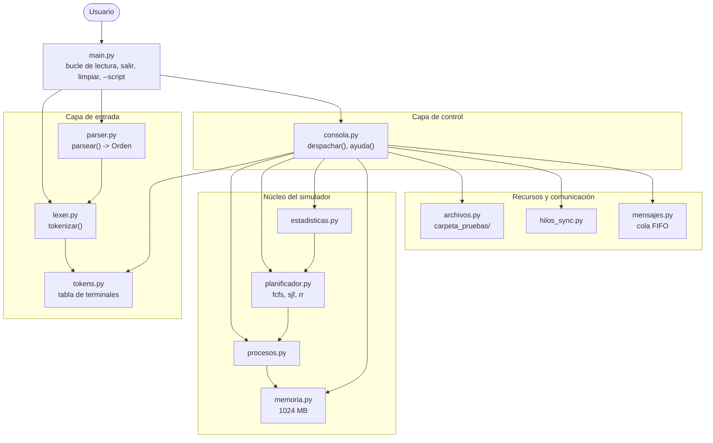

# ANDROMEDA — Documentación técnica del simulador de sistema operativo

> Documento único de referencia del proyecto: qué se hizo, por qué se usó un
> lexer, qué hace cada archivo, el menú de comandos y su sintaxis, el modelo de
> datos, los algoritmos de planificación y las pruebas.

---

## Índice

1. [Qué es ANDROMEDA](#1-qué-es-andromeda)
2. [Requisitos y ejecución](#2-requisitos-y-ejecución)
3. [Qué se hizo](#3-qué-se-hizo)
4. [Por qué se usó un lexer](#4-por-qué-se-usó-un-lexer)
5. [Arquitectura y flujo de una orden](#5-arquitectura-y-flujo-de-una-orden)
6. [Función de cada archivo](#6-función-de-cada-archivo)
7. [Menú, comandos y sintaxis](#7-menú-comandos-y-sintaxis)
8. [Modelo de datos](#8-modelo-de-datos)
9. [Algoritmos de planificación](#9-algoritmos-de-planificación)
10. [Pruebas y validación](#10-pruebas-y-validación)
11. [Referencias y pendientes](#11-referencias-y-pendientes)

---

## 1. Qué es ANDROMEDA

ANDROMEDA es un **simulador didáctico de un sistema operativo** con interfaz por
línea de comandos, escrito en **Python puro** para Linux. No es un kernel real ni
un emulador de hardware: reproduce de forma observable los conceptos clásicos de
un sistema operativo —procesos, planificación de CPU, memoria, archivos,
concurrencia y comunicación entre procesos— dentro de una sola terminal.

El usuario escribe una orden; el simulador la analiza, la valida y ejecuta la
acción correspondiente en el módulo adecuado, devolviendo siempre una respuesta
prefijada con `[OK]` o `[ERROR]`.

**Características principales:**

- Consola de comandos con prompt fijo `simulador> `.
- Lexer + parser propios (sin librerías externas de análisis).
- Gestión de procesos con estados y ciclo de vida.
- Tres planificadores: FCFS, SJF no expulsivo y Round Robin.
- Memoria simulada de 1024 MB con reserva y liberación.
- Operaciones de archivos confinadas a `carpeta_pruebas/`.
- Demostración real de concurrencia con `threading` (condición de carrera, Lock
  y Semaphore).
- Cola FIFO de mensajes con `queue.Queue`.
- Modo script para ejecutar una sesión de demostración desde un archivo.

**Fuera de alcance:** kernel real, virtualización, acceso a hardware, interfaz
gráfica, dependencias instaladas con `pip`, redes o persistencia entre
ejecuciones.

---

## 2. Requisitos y ejecución

### Requisitos

| Requisito | Detalle |
|---|---|
| Sistema objetivo | Linux |
| Python | 3.10 o superior |
| Dependencias | Solo biblioteca estándar (`re`, `dataclasses`, `threading`, `queue`, `enum`, `collections`, `pathlib`, `unittest`…) |
| Interfaz | Terminal de texto, sin GUI ni colores ANSI |
| Codificación | Archivos en UTF-8, saltos de línea LF |

### Ejecución interactiva

```bash
python3 main.py
```

Se muestra el prompt `simulador> `. Escribe una orden por línea. `Ctrl+C` no
termina el programa (avisa y vuelve al prompt); `Ctrl+D` o `salir` sí terminan.

### Modo script

```bash
python3 main.py --script pruebas/demo.txt
```

Ejecuta las líneas del archivo como si se escribieran en la consola. Las líneas
vacías y las que empiezan por `#` se ignoran. Si aparece `salir`, la ejecución
se detiene.

### Ejecutar las pruebas

```bash
python3 -m unittest discover -s pruebas -v
```

---

## 3. Qué se hizo

El proyecto se construyó por fases (0 Arranque → 5 Pruebas), con cuatro
responsables (A, B, C, D). El historial de git y el plan de trabajo
(`Tareas_por_Persona-1.md`) documentan el avance.

### Fases y tareas completadas

| Fase | Tareas | Resultado |
|---|---|---|
| **0 Arranque** | T0.1–T0.5 | Repositorio, convenciones, roles y confirmación con el docente. |
| **1 Diseño** | T1.1–T1.6 | Terminales, contrato de proceso, firmas/stubs, diagramas, pseudocódigo y borrador de diseño. |
| **2 Esqueleto** | T2.1, T2.3 | `main.py` con bucle de consola y `tokens.py` con la tabla de terminales. |
| **3 Desarrollo** | T3.1–T3.11 | Procesos, planificadores, estadísticas, lexer, memoria, archivos, parser, mensajes e hilos. |
| **4 Integración** | T4.1–T4.4 | Despachador `consola.py`, integración memoria-procesos, modo script y recorrido completo. |
| **5 Pruebas** | T5.1–T5.5 | Pruebas de lexer, algoritmos, errores, extremo a extremo y revisión cruzada. |
| **6 Documentación** | T6.1–T6.6 | Documento de diseño, diagramas, README, anexo léxico e informe. |
| **7 Sustentación** | T7.1–T7.3 | Guion, ensayos y plan B de la demo. |

### Responsables por módulo

| Persona | Área | Archivos |
|---|---|---|
| **A** | Núcleo: procesos, planificación y estadísticas | `procesos.py`, `planificador.py`, `estadisticas.py` |
| **B** | Lexer, memoria y archivos | `tokens.py`, `lexer.py`, `memoria.py`, `archivos.py` |
| **C** | Parser, consola e integración | `main.py`, `parser.py`, `consola.py`, `mensajes.py` |
| **D** | Concurrencia, Linux y documentación | `hilos_sync.py`, diagramas, informe |

### Lo que quedó implementado

- **Análisis de entrada:** `tokens.py` + `lexer.py` reconocen palabras
  reservadas, identificadores, nombres de archivo, números, cadenas con escapes,
  `=`, comentarios y errores con línea/columna.
- **Validación gramatical:** `parser.py` construye una `Orden` estructurada y
  lanza `ErrorSintaxis` con el uso correcto.
- **Despacho:** `consola.py` conecta cada orden con su módulo y formatea la
  respuesta.
- **Procesos:** ciclo de vida con estados y asignación automática de `pid`.
- **Planificación:** FCFS, SJF no expulsivo y Round Robin con Gantt, tiempos y
  promedios.
- **Estadísticas:** tabla de finalización, retorno, espera y promedios.
- **Memoria:** reserva/liberación con tope de 1024 MB.
- **Archivos:** CRUD seguro dentro de `carpeta_pruebas/`.
- **Concurrencia:** hilos reales en modos `sin_lock`, `con_lock` y `semaforo`.
- **Mensajes:** cola FIFO segura entre hilos.
- **Utilidades:** `ayuda`, `tokens`, `ejemplo`, `limpiar`, `salir` y modo
  `--script`.

> **Estado actual:** T4.1, T4.4, T5.4 y T6.1/T6.3 ya están integrados en
> `main`; el despachador conecta todos los comandos y las pruebas de error T5.3
> están integradas. La suite completa suma 155 pruebas.

---

## 4. Por qué se usó un lexer

Un **lexer** (analizador léxico) convierte el texto plano que escribe el usuario
en una secuencia de **tokens** con significado. Se eligió este enfoque por estas
razones:

1. **Separación de responsabilidades.** Cada etapa hace una sola cosa:
   `lexer` → reconoce piezas; `parser` → valida la gramática; `consola` →
   ejecuta. Así cada módulo se puede probar y mantener por separado.

2. **Errores precisos antes de tocar el sistema.** El lexer reporta el carácter
   o la cadena inválida con su **línea y columna** (`Token.ERROR`), de modo que
   el usuario sabe exactamente qué corregir sin ejecutar ninguna acción real.

3. **Una única fuente de palabras reservadas.** `tokens.py` centraliza las 36
   palabras clave y las clases de token. El lexer, el parser, la ayuda y el
   comando `tokens` leen de esa misma tabla: no hay listas duplicadas que se
   desincronicen.

4. **Robustez.** El requisito del proyecto es que **el programa nunca se caiga
   por una entrada inválida**. El lexer nunca lanza excepciones: ante algo que no
   reconoce emite un token `ERROR` y continúa el análisis. El parser luego decide
   si puede construir la orden o si debe responder con `[ERROR]`.

5. **Soporte de tipos ricos.** Distingue `NUMERO`, `ID`, `NOMBRE_ARCHIVO`,
   `CADENA` (con escapes `\n`, `\t`, `\"`, `\\`), `IGUAL`, palabras reservadas y
   `FIN`. Esto permite validaciones finas (por ejemplo, que un `pid` sea número y
   no una palabra).

6. **Valor didáctico y de depuración.** El comando `tokens` muestra en vivo cómo
   se clasifica cada elemento de una línea, lo que sirve para explicar el
   funcionamiento interno del simulador.

En resumen: el lexer aporta **claridad, detección temprana de errores, una tabla
única de terminales y tolerancia a fallos**, que son exactamente las cualidades
que exige un simulador didáctico que recibe entrada libre por teclado.

---

## 5. Arquitectura y flujo de una orden

### Capas

| Capa | Módulos | Responsabilidad |
|---|---|---|
| **Entrada** | `main.py`, `tokens.py`, `lexer.py`, `parser.py` | Leer, tokenizar y validar la orden. |
| **Control** | `consola.py` | Despachar la orden al módulo correcto y producir la respuesta. |
| **Núcleo** | `procesos.py`, `planificador.py`, `estadisticas.py`, `memoria.py` | Simular procesos, CPU y memoria. |
| **Recursos** | `archivos.py`, `hilos_sync.py`, `mensajes.py` | Archivos, concurrencia y comunicación. |

### Flujo

```text
texto -> lexer -> parser -> consola -> módulo -> [OK] / [ERROR]
```

1. `main.py` muestra `simulador> ` y lee una línea.
2. `lexer.tokenizar()` convierte el texto en tokens.
3. `parser.parsear()` valida la gramática y devuelve una `Orden`.
4. `consola.despachar()` elige el módulo correspondiente.
5. El módulo ejecuta la simulación y devuelve una respuesta.
6. `main.py` imprime un mensaje `[OK]` o `[ERROR]`.

Los errores léxicos o sintácticos vuelven al prompt **sin mostrar traceback**.
Los errores de validación de los módulos (`ValueError`, `OSError`) se capturan en
`consola.py` y se convierten en `[ERROR] ...`.

### Diagrama modular (Mermaid)



Las versiones PNG y SVG están en
[`docs/diagramas/`](docs/diagramas/) (`modular.png`, `modular.svg`,
`flujo_consola.png`, `flujo_consola.svg`) y el detalle en
[`docs/diagrama_modular.md`](docs/diagrama_modular.md).

---

## 6. Función de cada archivo

Cada ficha indica **responsable**, **función**, **entradas/salidas**,
**dependencias**, **API pública** y **estado**.

### 6.1 `main.py`

- **Responsable:** C.
- **Función:** punto de entrada. Bucle de lectura del prompt, manejo de
  `Ctrl+C`/`Ctrl+D`, atajos de `salir`, `limpiar` y `tokens`, y modo `--script`.
- **Entrada:** texto del usuario o archivo de script.
- **Salida:** texto en terminal.
- **Depende de:** `consola.py`, `lexer.py`, `parser.py`.
- **API:** `limpiar_pantalla()`, `ejecutar_linea(linea) -> bool`,
  `ejecutar_script(ruta)`, `main()`.
- **Notas:** `ejecutar_linea` devuelve `False` cuando hay que terminar. `limpiar`
  usa `cls`/`clear` según el sistema. `tokens` se atiende aquí (recorta el texto
  posterior a la palabra) antes de pasar por el despachador.

### 6.2 `consola.py`

- **Responsable:** C.
- **Función:** despachador. Convierte una `Orden` en la llamada al módulo
  correcto y formatea la respuesta con `[OK]`/`[ERROR]`. También implementa
  `ayuda` y `tokens`.
- **Entrada:** `Orden`.
- **Salida:** `str`.
- **Depende de:** `archivos`, `estadisticas`, `hilos_sync`, `memoria`,
  `mensajes`, `planificador`, `procesos`, `lexer`, `parser`, `tokens`.
- **API:** `despachar(orden) -> str`, `ayuda(palabra=None) -> str`,
  `mostrar_tokens(texto=None) -> str`.
- **Notas:**
  - Guarda `_ultimo_resultado` para que `estadisticas` muestre la última
    planificación.
  - `_gantt` rellena los huecos de CPU con `(libre)`.
  - `_tabla_procesos` y las tablas de archivos usan `ljust`/`rjust`.
  - Captura `ValueError`/`OSError` y los convierte en `[ERROR]` sin datos
    técnicos.
  - Casos especiales: `ejemplo` reinicia procesos y limpia el último resultado;
    `memoria` sin subcomando equivale a `memoria estado`.

### 6.3 `tokens.py`

- **Responsable:** B.
- **Función:** tabla central de terminales del lenguaje. Define las **36
  palabras reservadas**, las clases de token (`ID`, `NOMBRE_ARCHIVO`, `NUMERO`,
  `CADENA`, `IGUAL`, `FIN`, `ERROR`), sus definiciones y ejemplos.
- **Entrada:** ninguna.
- **Salida:** constantes y funciones de consulta.
- **API:**
  - `DefinicionToken` (dataclass con `palabra`, `tipo`, `definicion`,
    `ejemplo`, `sintaxis`).
  - `PALABRAS`, `PALABRAS_RESERVADAS`, `RESERVADAS`, `SIMBOLOS`, `TERMINALES`.
  - `buscar_definicion(palabra) -> DefinicionToken | None`.
  - `listar_definiciones() -> list[DefinicionToken]`.
- **Notas:** `SIMBOLOS = {"=": "IGUAL"}`. Las clases no forman parte de las
  palabras reservadas. Usado por `lexer`, `parser`, `procesos`, `archivos` y la
  ayuda.

### 6.4 `lexer.py`

- **Responsable:** B.
- **Función:** convierte una línea o bloque en una lista de `Token`.
- **Entrada:** `str`.
- **Salida:** `list[Token]` terminada siempre en un token `FIN`.
- **Depende de:** `tokens.py`.
- **API:** `Token` (dataclass frozen con `tipo`, `lexema`, `linea`,
  `columna`), `tokenizar(texto) -> list[Token]`.
- **Qué reconoce:**
  - Espacios, tabuladores y saltos de línea (con seguimiento de línea/columna).
  - Comentarios `# ...` hasta el fin de línea.
  - Nombres de archivo con extensión (`[A-Za-z0-9_-]+\.[A-Za-z0-9]+`), antes
    que los identificadores.
  - Palabras reservadas (sin distinguir mayúsculas) e identificadores (`ID`).
  - Números enteros no negativos.
  - Cadenas entre comillas dobles con escapes (`\n`, `\t`, `\"`, `\\`).
  - El símbolo `=` (`IGUAL`).
  - Caracteres inválidos o cadenas sin cerrar → `Token("ERROR", ...)`.
- **Notas:** nunca lanza excepción; ante un error emite `ERROR` y continúa.

### 6.5 `parser.py`

- **Responsable:** C.
- **Función:** valida la gramática de los tokens y construye una `Orden` para el
  despachador.
- **Entrada:** `list[Token]`.
- **Salida:** `Orden` o `ErrorSintaxis`.
- **Depende de:** `lexer.Token`.
- **API:** `Orden`, `ErrorSintaxis(ValueError)`, `parsear(tokens) -> Orden`.
- **Notas:**
  - `Orden` contiene `comando`, `subcomando`, `argumentos`, `atributos` y
    `linea_original`.
  - Exige la sintaxis canónica (`crear proceso ...`, `listar procesos`, etc.).
  - Rechaza nombres de proceso que sean palabras reservadas.
  - `crear` exige `cpu=<n>` (mínimo 1); `mem` se traduce al parámetro `memoria`.
  - `planificar rr` admite `quantum=<n>` (mínimo 1; por defecto 3).
  - `memoria` sin subcomando equivale a `memoria estado`.
  - `archivo crear` acepta texto opcional; `modificar` lo exige.
  - `tokens` acepta cualquier cosa después (es una herramienta de depuración).
  - Cada error incluye el uso correcto (`USO`) y, cuando aplica, la columna.

### 6.6 `procesos.py`

- **Responsable:** A.
- **Función:** registro y ciclo de vida de los procesos; asigna `pid`, reserva
  memoria al crear y libera al finalizar.
- **Entrada:** nombre, llegada, CPU, prioridad y memoria.
- **Salida:** `Proceso` o lista de procesos.
- **Depende de:** `memoria.py`, `tokens.py`.
- **API:**
  - `EstadoProceso` (Enum: `NUEVO`, `LISTO`, `EJECUTANDO`, `TERMINADO`,
    `RECHAZADO`).
  - `Proceso` (dataclass con validaciones en `__post_init__`).
  - `crear_proceso(nombre, llegada=0, cpu=1, prioridad=1, memoria=64)`.
  - `listar_procesos()`, `consultar_proceso(pid)`, `finalizar_proceso(pid)`.
  - `cargar_ejemplo()`, `reiniciar_procesos()`.
- **Reglas:**
  - Nombre `^[A-Za-z_][A-Za-z0-9_]*$`, único y no reservado.
  - Si hay memoria → estado `LISTO`; si no → `RECHAZADO` (conserva su `pid`).
  - No se puede finalizar un proceso que no esté `LISTO` o `EJECUTANDO`.
  - `cargar_ejemplo` reinicia el registro y carga P1–P4.

### 6.7 `planificador.py`

- **Responsable:** A.
- **Función:** simula FCFS, SJF no expulsivo y Round Robin.
- **Entrada:** `list[Proceso]`, algoritmo y quantum opcional.
- **Salida:** `ResultadoPlanificacion` (Gantt, tiempos y promedios).
- **Depende de:** `procesos.py`.
- **API:** `Ejecucion`, `TiempoProceso`, `ResultadoPlanificacion`, `fcfs()`,
  `sjf()`, `rr(procesos, quantum=3)`, `planificar(procesos, algoritmo,
  quantum=3)`.
- **Reglas:** no muta los procesos; solo considera los `LISTO`; desempata por
  `pid`; los huecos de CPU no generan `Ejecucion` (se muestran como `(libre)`).

### 6.8 `estadisticas.py`

- **Responsable:** A.
- **Función:** calcula y formatea los tiempos de una planificación.
- **Entrada:** `ResultadoPlanificacion`.
- **Salida:** `Estadisticas` y tabla de texto.
- **Depende de:** `planificador.py`.
- **API:** `Estadisticas`, `calcular_estadisticas(resultado)`,
  `formatear_estadisticas(estadisticas)`.
- **Notas:** ordena por `pid`, recalcula promedios y muestra dos decimales.

### 6.9 `memoria.py`

- **Responsable:** B.
- **Función:** administra una memoria simulada de **1024 MB**.
- **Entrada:** `pid` y cantidad de MB.
- **Salida:** `bool`, MB liberados o `EstadoMemoria`.
- **API:** `CAPACIDAD_TOTAL = 1024`, `EstadoMemoria`, `reservar(pid, cantidad)`,
  `liberar(pid)`, `estado_memoria()`, `reiniciar_memoria()`.
- **Notas:** rechaza pid/cantidad inválidos con `ValueError`; una reserva sin
  capacidad o para un `pid` ya asignado devuelve `False`; `liberar` devuelve los
  MB liberados (o `0`).

### 6.10 `archivos.py`

- **Responsable:** B.
- **Función:** CRUD de archivos **solo dentro de `carpeta_pruebas/`**.
- **Entrada:** nombre y contenido.
- **Salida:** `ArchivoInfo`, texto o `bool`.
- **API:** `ArchivoInfo`, `validar_nombre`, `crear_archivo`,
  `listar_archivos`, `leer_archivo`, `modificar_archivo`, `eliminar_archivo`,
  `existe_archivo`.
- **Seguridad:**
  - Rechaza rutas absolutas, `/`, `\`, `..` y enlaces que salgan de la carpeta.
  - Rechaza nombres cuya base sea una palabra reservada.
  - Crear no sobrescribe; modificar agrega al final; leer/modificar un archivo
    inexistente lanza `FileNotFoundError`; eliminar devuelve `False` si no
    existe.

### 6.11 `hilos_sync.py`

- **Responsable:** D.
- **Función:** demuestra la condición de carrera y su solución con hilos reales.
- **Entrada:** modo (`sin_lock`, `con_lock`, `semaforo`), hilos e iteraciones.
- **Salida:** `ResultadoConcurrencia`.
- **API:** `MODOS`, `ResultadoConcurrencia`, `ejecutar_concurrencia(modo,
  hilos=4, iteraciones=1000)`, `formatear_resultado(resultado)`.
- **Notas:** el incremento se separa en lectura y escritura con `time.sleep(0)`
  para que la carrera sea observable. `sin_lock` puede perder incrementos;
  `con_lock` usa `threading.Lock`; `semaforo` usa `threading.Semaphore(1)`.

### 6.12 `mensajes.py`

- **Responsable:** C.
- **Función:** cola FIFO de mensajes para todo el simulador.
- **Entrada:** texto.
- **Salida:** mensaje más antiguo o `None`.
- **API:** `enviar(texto)`, `recibir()`, `cantidad()`, `limpiar()`.
- **Notas:** usa `queue.Queue` (segura entre hilos). `recibir` no bloquea y
  devuelve `None` si la cola está vacía.

### 6.13 `carpeta_pruebas/`

Directorio sandbox donde `archivos.py` crea, lee, modifica y elimina archivos.
Se crea automáticamente si no existe. Ningún comando puede operar fuera de él.

### 6.14 `pruebas/`

| Archivo | Qué cubre |
|---|---|
| `test_lexer.py` | Tokenización: palabras, IDs, números, cadenas, escapes, archivos, errores y columnas. |
| `test_parser.py` | Órdenes válidas, errores de gramática y la sesión de demo. |
| `test_procesos.py` | Ciclo de vida, validaciones, `pid` y finalización. |
| `test_planificador.py` | FCFS, SJF, RR y `planificar`. |
| `test_algoritmos_borde.py` | Un proceso, CPU ociosa, quantum 1, quantum mayor que la CPU. |
| `test_estadisticas.py` | Cálculo de promedios y formato de tabla. |
| `test_integracion_memoria.py` | Reserva, rechazo por capacidad y liberación al finalizar. |
| `test_persona_b.py` | Memoria, archivos, sandbox, `ayuda` y `tokens`. |
| `test_hilos_sync.py` | Los tres modos de concurrencia. |
| `test_mensajes.py` | Cola FIFO y patrón productor/consumidor. |
| `test_errores.py` | Casos de error de la consola (T5.3): nunca debe verse traceback. |
| `demo.txt` | Guion de demostración ejecutable con `--script`. |

### 6.15 `docs/`

| Archivo | Contenido |
|---|---|
| `documento_diseno.md` | Problema, objetivos, arquitectura, módulos y estado (T1.6). |
| `contrato_proceso.md` | Contrato de `Proceso`, estados y contrato de planificadores (T1.2). |
| `firmas_modulos.md` | Firmas públicas y comportamiento de los stubs (T1.3). |
| `terminales_sintaxis.md` | Terminales, gramática y sintaxis propuesta (T1.1). |
| `pseudocodigo_planificadores.md` | Pseudocódigo y diagramas de FCFS/SJF/RR (T1.5). |
| `diagrama_modular.md` | Diagrama modular y de flujo de consola (T1.4). |
| `diagramas/` | Versiones PNG/SVG de los diagramas. |

---

## 7. Menú, comandos y sintaxis

ANDROMEDA no usa un menú gráfico: **el menú es la propia consola**. El comando
`ayuda` actúa como menú integrado y lista los comandos principales; `ayuda
<comando>` muestra la definición y un ejemplo. Los comandos se escriben en
**minúsculas y sin tildes** (el lexer tolera mayúsculas, pero la forma oficial
es minúscula).

### 7.1 Tabla de comandos principales

| Comando | Sintaxis | Módulo | Resultado |
|---|---|---|---|
| `crear` | `crear proceso <nombre> cpu=<n> [llegada=<n>] [prioridad=<n>] [mem=<n>]` | `procesos` | Crea el proceso y reserva memoria; queda `LISTO` o `RECHAZADO`. |
| `listar` | `listar procesos` | `procesos` | Tabla de procesos registrados. |
| `consultar` | `consultar proceso <pid>` | `procesos` | Datos de un proceso. |
| `finalizar` | `finalizar proceso <pid>` | `procesos` | Marca `TERMINADO` y libera memoria. |
| `planificar` | `planificar fcfs` \| `planificar sjf` \| `planificar rr [quantum=<n>]` | `planificador` | Gantt, promedios de retorno y espera. |
| `estadisticas` | `estadisticas` | `estadisticas` | Tabla de la última planificación. |
| `concurrencia` | `concurrencia sin_lock` \| `concurrencia con_lock` \| `concurrencia semaforo` | `hilos_sync` | Valor esperado vs obtenido con hilos. |
| `mensaje` | `mensaje enviar "<texto>"` \| `mensaje recibir` | `mensajes` | Envía o recibe de la cola FIFO. |
| `memoria` | `memoria` \| `memoria estado` \| `memoria asignar <pid> <mb>` \| `memoria liberar <pid>` | `memoria` | Estado, reserva o liberación de memoria. |
| `archivo` | `archivo crear <nombre.ext> ["<texto>"]` \| `archivo listar` \| `archivo leer <nombre.ext>` \| `archivo modificar <nombre.ext> "<texto>"` \| `archivo eliminar <nombre.ext>` | `archivos` | CRUD dentro de `carpeta_pruebas/`. |
| `ejemplo` | `ejemplo` | `procesos` | Reinicia y carga P1–P4. |
| `ayuda` | `ayuda` \| `ayuda <palabra>` | `consola`/`tokens` | Menú general o detalle de un comando. |
| `tokens` | `tokens` \| `tokens <texto>` | `lexer` | Tabla de terminales o tokens de un texto. |
| `limpiar` | `limpiar` | `main` | Limpia la pantalla. |
| `salir` | `salir` | `main` | Termina el simulador. |

### 7.2 Subcomandos y operaciones

**Procesos**

```text
crear proceso <nombre> cpu=<n> [llegada=<n>] [prioridad=<n>] [mem=<n>]
listar procesos
consultar proceso <pid>
finalizar proceso <pid>
```

- `nombre`: letras, dígitos y `_`; debe empezar por letra o `_`; único; no puede
  ser palabra reservada.
- `cpu` es obligatorio (≥ 1). `llegada` ≥ 0, `prioridad` ≥ 0, `mem` ≥ 1.
- Los valores por defecto son `llegada=0`, `prioridad=1`, `memoria=64`.
- Prioridad: **menor número = mayor prioridad** (como `nice` en Linux).

**Planificación**

```text
planificar fcfs
planificar sjf
planificar rr
planificar rr quantum=<n>
```

- `quantum` por defecto es 3; debe ser ≥ 1.
- Solo se planifican procesos en estado `LISTO`.

**Memoria**

```text
memoria
memoria estado
memoria asignar <pid> <mb>
memoria liberar <pid>
```

- Capacidad total: 1024 MB.
- `memoria` sin argumentos equivale a `memoria estado`.

**Archivos**

```text
archivo crear <nombre.ext> ["<texto>"]
archivo listar
archivo leer <nombre.ext>
archivo modificar <nombre.ext> "<texto>"
archivo eliminar <nombre.ext>
```

- Solo archivos simples dentro de `carpeta_pruebas/`.
- Se rechazan rutas absolutas, `..`, `/`, `\` y nombres reservados.

**Concurrencia**

```text
concurrencia sin_lock
concurrencia con_lock
concurrencia semaforo
```

**Mensajes**

```text
mensaje enviar "<texto>"
mensaje recibir
```

**Utilidades**

```text
ayuda
ayuda planificar
tokens
tokens crear proceso editor llegada=0 cpu=8
ejemplo
limpiar
salir
```

### 7.3 Convenciones de salida

- Todo mensaje de éxito empieza con `[OK]` y una explicación breve.
- Todo mensaje de fallo empieza con `[ERROR]` y una explicación breve.
- Los errores de sintaxis incluyen el uso correcto y, cuando aplica, la columna.
- No se muestran tracebacks; una entrada inválida nunca tumba el programa.
- Ejemplos:

```text
[OK] Proceso 1 'P1' creado en estado LISTO.
[ERROR] No hay memoria suficiente para el proceso 'P5' (2000 MB); quedo Rechazado.
[ERROR] se esperaba 'proceso' pero se encontro 'editor' en la columna 7
Uso: crear proceso <nombre> cpu=<n> [llegada=<n>] [prioridad=<n>] [mem=<n>]
```

### 7.4 Sesión de ejemplo

```text
simulador> ejemplo
simulador> listar procesos
simulador> consultar proceso 2
simulador> planificar fcfs
simulador> estadisticas
simulador> planificar sjf
simulador> planificar rr quantum=3
simulador> memoria estado
simulador> concurrencia con_lock
simulador> mensaje enviar "hola"
simulador> mensaje recibir
simulador> archivo crear notas.txt "primera linea"
simulador> archivo leer notas.txt
simulador> salir
```

La versión ejecutable de esta sesión está en
[`pruebas/demo.txt`](pruebas/demo.txt) y se lanza con `--script`.

---

## 8. Modelo de datos

### 8.1 Estructuras principales

| Estructura | Campos principales | Uso |
|---|---|---|
| `Token` | `tipo`, `lexema`, `linea`, `columna` | Salida del lexer. |
| `Orden` | `comando`, `subcomando`, `argumentos`, `atributos`, `linea_original` | Salida del parser. |
| `Proceso` | `pid`, `nombre`, `llegada`, `cpu`, `prioridad`, `memoria`, `estado` | Proceso simulado. |
| `Ejecucion` | `pid`, `nombre`, `inicio`, `fin` | Segmento continuo del Gantt. |
| `TiempoProceso` | `pid`, `nombre`, `llegada`, `cpu`, `inicio`, `fin`, `retorno`, `espera` | Tiempos calculados. |
| `ResultadoPlanificacion` | `algoritmo`, `quantum`, `ejecuciones`, `tiempos`, `promedio_retorno`, `promedio_espera` | Salida del planificador. |
| `Estadisticas` | `algoritmo`, `tiempos`, `promedio_retorno`, `promedio_espera` | Salida de estadísticas. |
| `EstadoMemoria` | `total`, `usada`, `libre`, `asignaciones` | Estado de memoria. |
| `ArchivoInfo` | `nombre`, `tamano` | Archivo del sandbox. |
| `ResultadoConcurrencia` | `modo`, `valor_esperado`, `valor_obtenido`, `correcto`, `detalle` | Resultado de hilos. |
| `DefinicionToken` | `palabra`, `tipo`, `definicion`, `ejemplo`, `sintaxis` | Fila de la tabla de terminales. |

### 8.2 Estados del proceso

| Estado | Significado |
|---|---|
| `NUEVO` | Construido, aún no se decidió si se admite. |
| `LISTO` | Admitido, con memoria reservada, esperando CPU. |
| `EJECUTANDO` | Tiene la CPU (reservado para ejecución en vivo o extensión futura). |
| `TERMINADO` | Terminó o fue finalizado; su memoria fue liberada. |
| `RECHAZADO` | No admitido por falta de memoria. |

### 8.3 Transiciones permitidas

| Desde | Hacia | Condición |
|---|---|---|
| `NUEVO` | `LISTO` | La memoria solicitada fue reservada. |
| `NUEVO` | `RECHAZADO` | No hay memoria suficiente. |
| `LISTO` | `EJECUTANDO` | El proceso recibe la CPU. |
| `EJECUTANDO` | `LISTO` | Round Robin lo interrumpe y le queda CPU. |
| `EJECUTANDO` | `TERMINADO` | Consume todo su tiempo de CPU. |
| `LISTO` / `EJECUTANDO` | `TERMINADO` | Se ejecuta `finalizar proceso`. |
| `TERMINADO` / `RECHAZADO` | — | Son estados finales. |

> Nota: `planificar` es una **simulación**; no cambia estados ni memoria. Se
> puede planificar varias veces con los mismos procesos y el resultado es
> idéntico.

### 8.4 Fórmulas de tiempo

```text
retorno = fin - llegada
espera  = retorno - cpu
promedio_retorno = suma(retorno) / cantidad
promedio_espera  = suma(espera)  / cantidad
```

---

## 9. Algoritmos de planificación

Los tres algoritmos operan solo sobre procesos `LISTO`, no mutan los objetos
`Proceso` y desempatan por `pid` ascendente.

### 9.1 FCFS (First Come, First Served)

- Ordena por `(llegada, pid)` y ejecuta cada proceso completo, sin expropiación.
- `inicio = max(t, llegada)`, `fin = inicio + cpu`.

### 9.2 SJF no expulsivo

- Cuando la CPU queda libre, elige entre los procesos ya llegados el de menor
  `(cpu, llegada, pid)` y lo ejecuta completo.
- Si no hay disponibles, avanza hasta la siguiente llegada.

### 9.3 Round Robin

- Cola FIFO con `collections.deque`.
- Cada proceso ejecuta como máximo `quantum` unidades o hasta terminar.
- Al final de un quantum primero se encolan las llegadas de ese instante y luego
  se reencola el proceso interrumpido.
- Un mismo `pid` puede aparecer varias veces en `ejecuciones`.

### 9.4 Datos verificados P1–P4

Procesos de ejemplo (`ejemplo`):

| Proceso | Llegada | CPU | Prioridad | Memoria (MB) |
|---|---:|---:|---:|---:|
| P1 | 0 | 8 | 2 | 128 |
| P2 | 1 | 4 | 1 | 64 |
| P3 | 2 | 9 | 3 | 256 |
| P4 | 3 | 5 | 2 | 100 |

Consumen 548 MB de memoria y quedan en `LISTO`.

| Comando | Gantt | Finalización (P1–P4) | Retorno prom. | Espera prom. |
|---|---|---|---:|---:|
| `planificar fcfs` | P1, P2, P3, P4 | 8, 12, 21, 26 | 15.25 | 8.75 |
| `planificar sjf` | P1, P2, P4, P3 | 8, 12, 26, 17 | 14.25 | 7.75 |
| `planificar rr quantum=3` | P1, P2, P3, P4, P1, P2, P3, P4, P1, P3 | 23, 16, 26, 21 | 20.00 | 13.50 |

Estos valores coinciden con `docs/contrato_proceso.md` y
`docs/pseudocodigo_planificadores.md`.

---

## 10. Pruebas y validación

### 10.1 Ejecución

```bash
python3 -m unittest discover -s pruebas -v
```

### 10.2 Validaciones realizadas

- Lexer y parser: casos válidos e inválidos, con columna.
- Procesos: validaciones, `pid` automático y liberación de memoria.
- Planificadores: P1–P4 y casos borde (un proceso, CPU ociosa, quantum 1,
  quantum mayor que la CPU).
- Estadísticas: promedios y formato de tabla.
- Integración memoria-procesos: reserva, rechazo por capacidad y liberación.
- Archivos: sandbox, rutas inseguras y palabras reservadas.
- Concurrencia: los tres modos y comparación esperado/obtenido.
- Mensajes: FIFO y productor/consumidor.
- Errores de consola: ninguna entrada inválida muestra traceback.

### 10.3 Modo script como prueba de humo

```bash
python3 main.py --script pruebas/demo.txt
```

Recorre ayuda, tokens, ejemplo, los tres planificadores, estadísticas, memoria,
concurrencia, mensajes, archivos y errores de sintaxis en una sola sesión.

---

## 11. Referencias y pendientes

### Referencias internas

- [`README.md`](README.md) — requisitos, convenciones y ejecución.
- [`docs/documento_diseno.md`](docs/documento_diseno.md) — documento de diseño.
- [`docs/contrato_proceso.md`](docs/contrato_proceso.md) — contrato de proceso y
  planificadores.
- [`docs/firmas_modulos.md`](docs/firmas_modulos.md) — firmas públicas y stubs.
- [`docs/terminales_sintaxis.md`](docs/terminales_sintaxis.md) — terminales y
  gramática.
- [`docs/pseudocodigo_planificadores.md`](docs/pseudocodigo_planificadores.md) —
  pseudocódigo y diagramas de los algoritmos.
- [`docs/diagrama_modular.md`](docs/diagrama_modular.md) — diagramas modular y de
  flujo.
- [`docs/diagramas/`](docs/diagramas/) — versiones PNG/SVG.
- [`Tareas_por_Persona-1.md`](Tareas_por_Persona-1.md) — plan de trabajo.

### Pendientes de documentación y cierre

- Revisiones cruzadas B → C, C → D y D → A de T5.5.
- Congelación de la versión T5.6, a cargo de C.
- Actualizar el diagrama modular con lo realmente implementado (T6.2).
- Informe final con pruebas, resultados y conclusiones (T6.4).
- Ensayos de la demo y sustentación (T7.1–T7.2); el guion está en
  `docs/guion_demo.md`.
- Plan B de la demo (T7.3).

---

*Documento generado a partir del código actual, el historial de git y la
documentación de diseño del repositorio ANDROMEDA.*
