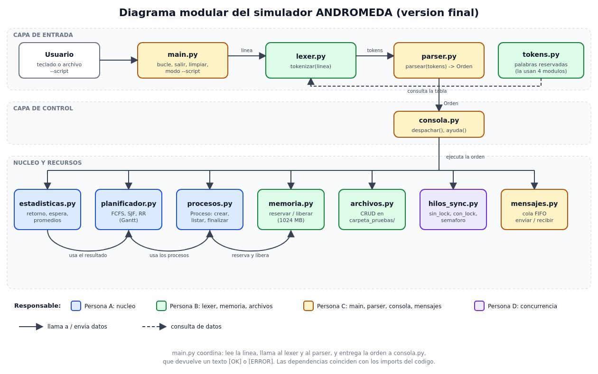
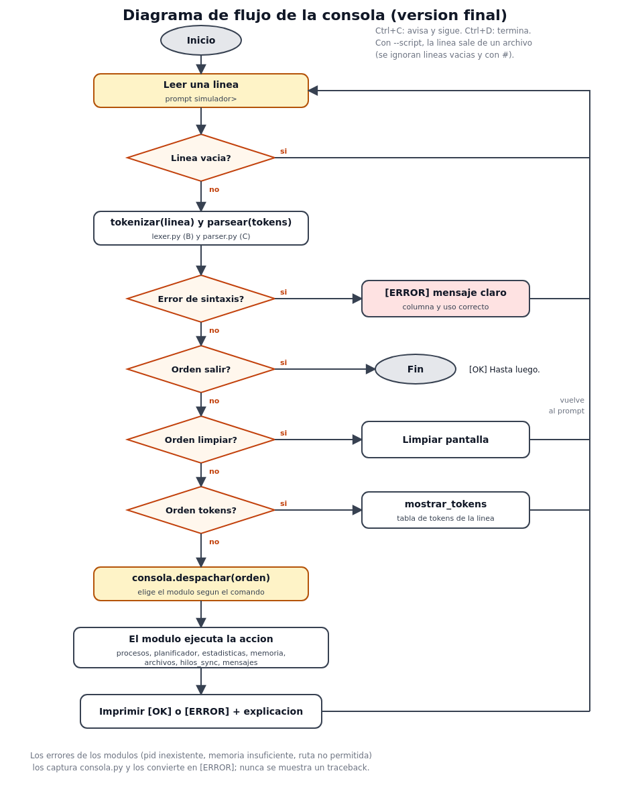

# Diagrama modular y de flujo (versión final)

- **Tareas:** T1.4 (diseño) y T6.2 (actualización con lo implementado)
- **Responsable:** D
- **Versión documentada:** `main`, commit `839b770`
- Las dependencias de este documento se verificaron contra los `import` del código.

## 1. Diagrama modular



Versión vectorial: `diagramas/modular.svg`.

`main.py` coordina el flujo: lee la línea, llama al lexer y al parser, y entrega la orden
a `consola.py`, que ejecuta el módulo correspondiente y devuelve el texto de salida.

### Dependencias reales entre módulos

| Módulo | Importa a |
|---|---|
| `main.py` | `lexer`, `parser`, `consola` |
| `consola.py` | `procesos`, `planificador`, `estadisticas`, `memoria`, `archivos`, `hilos_sync`, `mensajes`, `lexer`, `parser`, `tokens` |
| `parser.py` | `lexer` |
| `lexer.py` | `tokens` |
| `procesos.py` | `memoria`, `tokens` |
| `planificador.py` | `procesos` |
| `estadisticas.py` | `planificador` |
| `archivos.py` | `tokens` |
| `tokens.py`, `memoria.py`, `hilos_sync.py`, `mensajes.py` | (ninguno del proyecto) |

## 2. Descripción de cada módulo

| Módulo | Responsable | Función principal | Entra | Sale |
|---|---|---|---|---|
| `main.py` | C | Bucle de lectura; atiende `salir`, `limpiar`, `tokens` y el modo `--script`. | Texto del usuario o archivo. | Texto en pantalla. |
| `tokens.py` | B | Tabla de palabras reservadas y terminales. | — | Definiciones. |
| `lexer.py` | B | Convierte una línea en tokens, con línea y columna. | `str` | `list[Token]` terminada en `FIN`. |
| `parser.py` | C | Valida la gramática y arma la orden. | `list[Token]` | `Orden` o `ErrorSintaxis`. |
| `consola.py` | C | Despachador: elige el módulo según el comando y da formato a la salida. | `Orden` | `str` con `[OK]` o `[ERROR]`. |
| `procesos.py` | A | Registro y ciclo de vida de procesos; reserva memoria al crear. | Datos del proceso. | `Proceso`. |
| `planificador.py` | A | FCFS, SJF no expulsivo y Round Robin. | `list[Proceso]` | `ResultadoPlanificacion` (Gantt y tiempos). |
| `estadisticas.py` | A | Finalización, retorno, espera y promedios. | `ResultadoPlanificacion` | Tabla de texto. |
| `memoria.py` | B | Reserva y liberación con tope de 1024 MB. | `pid`, MB. | `bool`, MB liberados, estado. |
| `archivos.py` | B | CRUD de archivos confinado a `carpeta_pruebas/`. | Nombre y contenido. | `ArchivoInfo`, texto. |
| `hilos_sync.py` | D | Demostración de condición de carrera, Lock y Semaphore. | Modo, hilos, iteraciones. | `ResultadoConcurrencia`. |
| `mensajes.py` | C | Cola FIFO de mensajes. | Texto. | Mensaje o `None`. |

## 3. Diagrama de flujo de la consola



Versión vectorial: `diagramas/flujo_consola.svg`.

Reglas del flujo:

- Una línea vacía se ignora y vuelve al prompt.
- Primero se tokeniza y se parsea. Un error léxico (carácter no reconocido) o de gramática
  muestra `[ERROR]` con la columna y el uso correcto, y vuelve al prompt.
- `salir` termina el programa, `limpiar` limpia la pantalla y `tokens` muestra la tabla de
  tokens de la línea. Estas tres órdenes las atiende `main.py`.
- Cualquier otra orden pasa a `consola.despachar()`, que llama al módulo correspondiente.
- Los errores de los módulos (pid inexistente, memoria insuficiente, ruta no permitida) los
  captura `consola.py` y los convierte en `[ERROR]`. Nunca se muestra un traceback.
- En modo `--script`, el mismo flujo se repite por cada línea del archivo; se ignoran las
  líneas vacías y las que empiezan con `#`.

## 4. Flujos de datos relevantes

**Crear un proceso con memoria**

```text
crear proceso P1 cpu=8 mem=200
  -> procesos.crear_proceso()
       -> memoria.reservar(pid, 200)
            True : estado LISTO       -> [OK] Proceso 1 creado en estado LISTO.
            False: estado RECHAZADO   -> el proceso queda registrado como RECHAZADO
finalizar proceso 1
  -> procesos.finalizar_proceso() -> memoria.liberar(pid)
```

**Planificar**

```text
planificar rr quantum=3
  -> procesos.listar_procesos()          # solo los que están LISTO
  -> planificador.planificar(procesos, "RR", 3)   # Gantt y tiempos
estadisticas
  -> estadisticas.calcular_estadisticas() y formatear_estadisticas()
```

**Concurrencia**

```text
concurrencia con_lock
  -> hilos_sync.ejecutar_concurrencia("con_lock")
  -> hilos_sync.formatear_resultado()    # esperado vs obtenido, [OK] o [ERROR]
```

## 5. Cambios respecto al diseño inicial (T1.4)

- `main.py` ya integra el parser y el despachador; antes solo imprimía tokens.
- La dependencia `procesos` → `memoria` ya está implementada (reserva al crear, liberación al
  finalizar).
- `tokens.py` también lo usan `consola.py` (ayuda), `procesos.py` y `archivos.py`, para
  rechazar nombres que coinciden con palabras reservadas.
- `consola.py` quedó como único punto de entrada a los módulos del núcleo y de los recursos.
- El comando de concurrencia quedó como `concurrencia sin_lock|con_lock|semaforo`.
