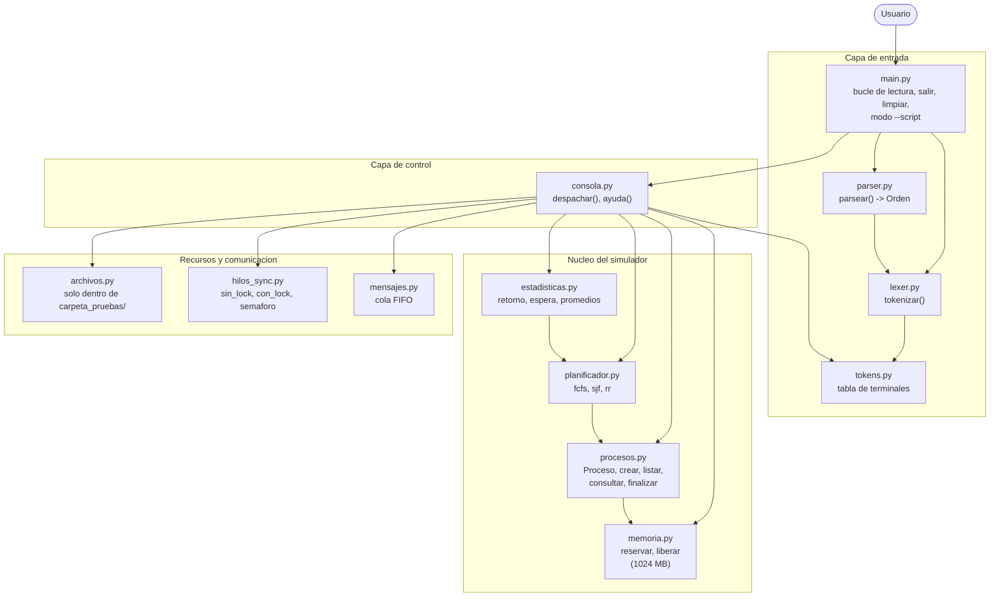
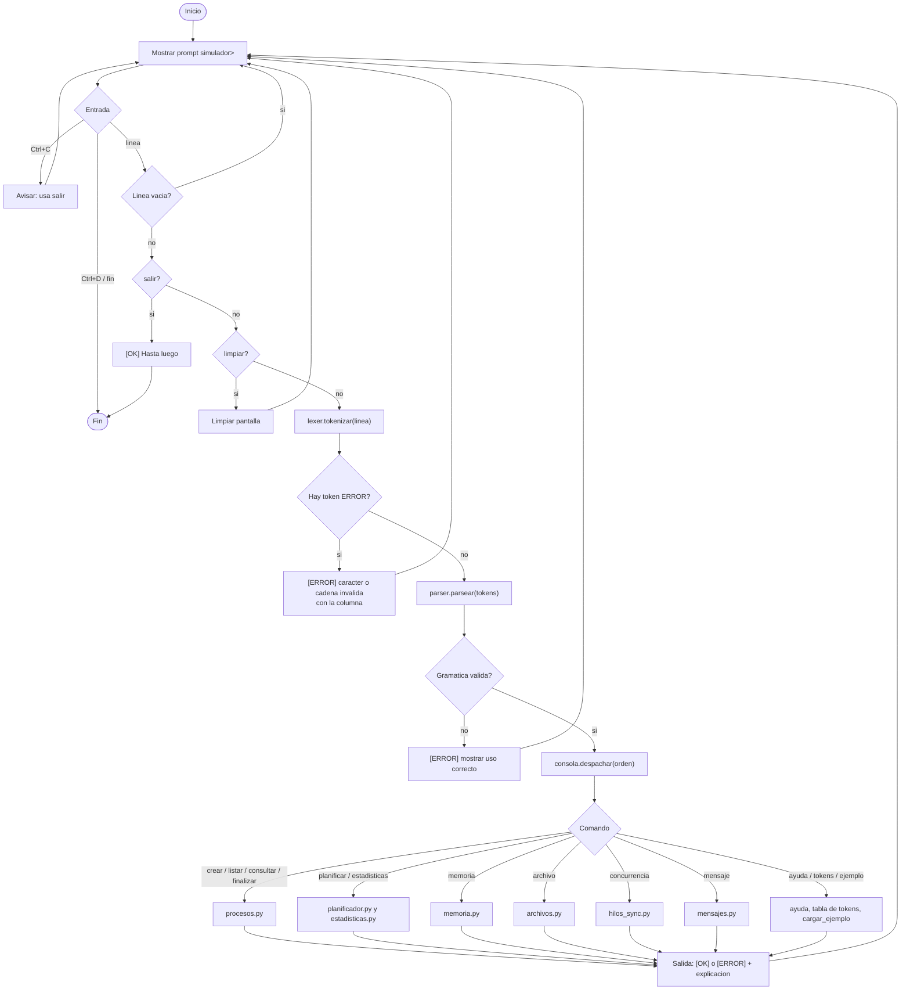

# Diagrama modular y de flujo

- **Tarea:** T1.4
- **Fase:** 1. Diseno
- **Responsable:** D
- **Depende de:** T1.1 (B), T1.3 (todos)
- **Estado:** v1 (diseno). En T6.2 se actualiza con lo realmente implementado.

Los nombres de modulos y funciones salen de `docs/firmas_modulos.md`.

## 1. Diagrama modular


Version vectorial: `diagramas/modular.svg`. El bloque Mermaid de abajo es el mismo diagrama en codigo, util para editarlo.

Cada caja es un archivo `.py`. Las flechas indican "usa a".



Version en texto, por si Mermaid no se renderiza:

```text
                         Usuario
                            |
                         main.py  ------------------ (modo --script)
                            |
              +-------------+-------------+
              |                           |
          lexer.py  <--- tokens.py     parser.py
              |__________________________|
                            |  Orden
                        consola.py  (despachar / ayuda)
                            |
   +--------+--------+------+------+---------+---------+
   |        |        |      |      |         |         |
procesos  planif.  estad.  memoria archivos hilos_sync mensajes
   |  \       |       |
   |   \      v       v
   |    +-> procesos  planificador
   v
memoria
```

## 2. Descripcion de cada modulo

| Modulo | Responsable | Funcion principal | Entra | Sale |
|---|---|---|---|---|
| `main.py` | C | Bucle de lectura; atiende `salir`, `limpiar` y `--script`. | Texto del usuario. | Texto en pantalla. |
| `tokens.py` | B | Tabla de palabras reservadas y terminales. | - | Definiciones. |
| `lexer.py` | B | Convierte una linea en tokens. | `str` | `list[Token]` terminada en `FIN`. |
| `parser.py` | C | Valida la gramatica y arma la orden. | `list[Token]` | `Orden` o `ValueError`. |
| `consola.py` | C | Despachador: elige el modulo segun la orden. | `Orden` | `str` con `[OK]` o `[ERROR]`. |
| `procesos.py` | A | Registro y ciclo de vida de procesos. | Datos del proceso. | `Proceso`. |
| `planificador.py` | A | FCFS, SJF no expulsivo y Round Robin. | `list[Proceso]` | `ResultadoPlanificacion` (Gantt y tiempos). |
| `estadisticas.py` | A | Finalizacion, retorno, espera y promedios. | `ResultadoPlanificacion` | Tabla de texto. |
| `memoria.py` | B | Reserva y liberacion con tope de 1024 MB. | `pid`, MB. | `bool`, MB liberados, estado. |
| `archivos.py` | B | CRUD de archivos confinado a `carpeta_pruebas/`. | Nombre y contenido. | `ArchivoInfo`, texto. |
| `hilos_sync.py` | D | Demostracion de condicion de carrera, Lock y Semaphore. | Modo, hilos, iteraciones. | `ResultadoConcurrencia`. |
| `mensajes.py` | C | Cola FIFO de mensajes. | Texto. | Mensaje o `None`. |

## 3. Diagrama de flujo de la consola


Version vectorial: `diagramas/flujo_consola.svg`. El bloque Mermaid de abajo es el mismo flujo en codigo.



Reglas del flujo:

- Un error en cualquier etapa vuelve al prompt; el programa nunca se cae ni muestra un traceback.
- Los modulos del nucleo lanzan `ValueError` en validaciones; `consola.py` los captura y los convierte en `[ERROR] ...`.
- En modo `--script`, el mismo flujo se repite por cada linea del archivo, sin leer del teclado.

## 4. Flujos de datos relevantes

**Crear un proceso con memoria (T4.2)**

```text
crear proceso P1 ... mem=200
  -> procesos.crear_proceso()
       -> memoria.reservar(pid, 200)
            si True : estado LISTO       -> [OK] Proceso 1 creado.
            si False: estado RECHAZADO   -> [ERROR] Memoria insuficiente.
finalizar proceso 1
  -> procesos.finalizar_proceso() -> memoria.liberar(pid)
```

**Planificar**

```text
planificar rr quantum=3
  -> procesos.listar_procesos()
  -> planificador.planificar(procesos, "RR", 3)   # Gantt + tiempos
  -> estadisticas.calcular_estadisticas()
  -> estadisticas.formatear_estadisticas()         # tabla en consola
```

**Concurrencia**

```text
concurrencia con_lock
  -> hilos_sync.ejecutar_concurrencia("con_lock")
  -> hilos_sync.formatear_resultado()   # esperado vs obtenido
```

## 5. Pendientes para T6.2

- Confirmar el nombre final del comando de concurrencia (`concurrencia` o `hilos`); ver `docs/terminales_sintaxis.md`.
- Anotar si C agrego dependencias que no estan en este diagrama.
- Revisar que `main.py` ya use `parser` y `consola` en lugar de solo imprimir tokens.
