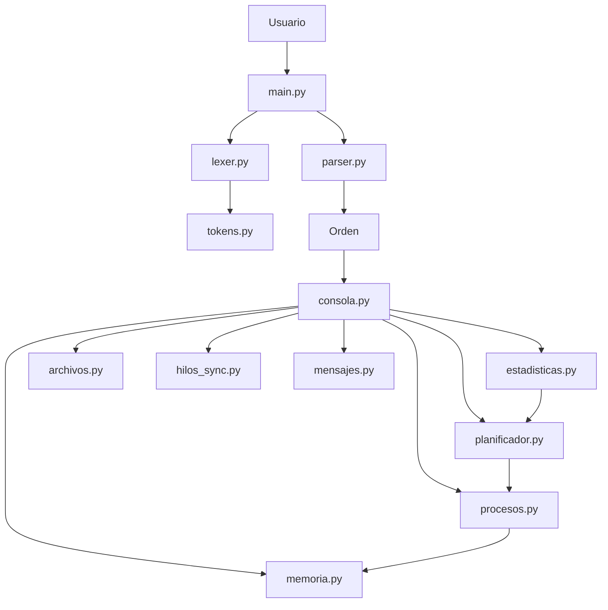

# Documento de Diseño del Simulador de SO

- **Tarea:** T1.6
- **Fase:** 1. Diseño
- **Responsables:** A, B, C, D
- **Depende de:** T1.3, T1.4
- **Estado:** Borrador v1
- **Sistema objetivo:** Linux
- **Requisitos:** Python 3.10 o superior, solo biblioteca estándar.

Este es el borrador del documento de diseño del simulador de sistema operativo
ANDROMEDA. Describe el problema, los objetivos, la arquitectura, los módulos y
el estado actual del proyecto. La versión final se consolida en T6.1.

## 1. Problema

El equipo necesita construir un simulador didáctico de un sistema operativo que
permita observar conceptos de planificación de procesos, memoria, archivos,
concurrencia y comunicación entre procesos sin depender de un kernel real ni de
una interfaz gráfica.

El simulador debe:

- Ejecutarse en Linux desde una terminal.
- Recibir órdenes escritas por el usuario.
- Validar las órdenes antes de ejecutar acciones.
- Mostrar resultados claros en texto.
- No caerse ante entradas inválidas.
- Usar únicamente Python 3.10+ y la biblioteca estándar.

La consola de comandos sustituye a un menú gráfico. Cada línea se procesa como
una orden y el usuario recibe una respuesta `[OK]` o `[ERROR]`.

## 2. Objetivos

### 2.1 Objetivo general

Construir un simulador de sistema operativo por línea de comandos que integre
lexer, parser, despachador y módulos de simulación, con resultados verificables
y documentación reproducible.

### 2.2 Objetivos específicos

- Implementar un lexer que reconozca comandos, identificadores, números,
  cadenas, atributos, archivos y errores con línea y columna.
- Implementar un parser que valide la gramática y produzca una orden
  estructurada.
- Implementar un despachador que conecte cada orden con el módulo correcto.
- Gestionar procesos con estados, memoria y finalización.
- Simular FCFS, SJF no expulsivo y Round Robin con Gantt, tiempos y promedios.
- Simular una memoria de 1024 MB con reserva y liberación.
- Restringir las operaciones de archivos a `carpeta_pruebas/`.
- Demostrar condición de carrera, Lock y Semaphore con hilos reales.
- Implementar una cola FIFO de mensajes.
- Cubrir las funciones con pruebas unitarias y documentar los resultados.

## 3. Alcance y limitaciones

### 3.1 Incluido

- Consola de comandos sin interfaz gráfica.
- Lexer, parser y despachador.
- Gestión de procesos y planificación.
- Memoria simulada de 1024 MB.
- Archivos dentro de `carpeta_pruebas/`.
- Demostración de concurrencia con hilos.
- Cola de mensajes FIFO.
- Comandos `ayuda`, `tokens`, `ejemplo`, `limpiar` y `salir`.
- Pruebas con `unittest`.
- Documentación en Markdown.

### 3.2 Fuera de alcance

- Un kernel o sistema operativo real.
- Virtualización o acceso directo al hardware.
- Interfaz gráfica, ventanas o frameworks web.
- Dependencias externas instaladas con `pip`.
- Redes, sockets o servicios en segundo plano.
- Persistencia de procesos entre ejecuciones.
- Apropiación real de CPU o planificación del sistema anfitrión.

## 4. Arquitectura

La arquitectura se organiza en cuatro capas. El diagrama modular completo está
en [`docs/diagrama_modular.md`](./diagrama_modular.md), con versiones PNG y SVG
en [`docs/diagramas/`](./diagramas/). El flujo de la consola está en
[`docs/diagramas/flujo_consola.png`](./diagramas/flujo_consola.png).

| Capa | Módulos | Responsabilidad |
|---|---|---|
| Entrada | `main.py`, `tokens.py`, `lexer.py`, `parser.py` | Leer, tokenizar y validar la orden. |
| Control | `consola.py` | Despachar la orden al módulo correcto y producir la respuesta. |
| Núcleo | `procesos.py`, `planificador.py`, `estadisticas.py`, `memoria.py` | Simular procesos, CPU y memoria. |
| Recursos | `archivos.py`, `hilos_sync.py`, `mensajes.py` | Archivos, concurrencia y comunicación. |



### 4.1 Flujo de una orden

1. `main.py` muestra el prompt `simulador> ` y lee una línea.
2. `lexer.tokenizar()` convierte el texto en tokens.
3. `parser.parsear()` valida la gramática y devuelve una `Orden`.
4. `consola.despachar()` elige el módulo correspondiente.
5. El módulo ejecuta la simulación y devuelve una respuesta.
6. `main.py` imprime un mensaje `[OK]` o `[ERROR]`.

```text
texto -> lexer -> parser -> consola -> módulo -> [OK] / [ERROR]
```

Los errores léxicos o sintácticos vuelven al prompt sin mostrar traceback. Los
errores de validación de los módulos se convierten en `[ERROR] ...`.

## 5. Descripción de los módulos

### 5.1 `tokens.py`

- **Responsable:** B.
- **Función:** tabla central de 36 palabras reservadas y clases de token.
- **Entrada:** ninguna.
- **Salida:** `PALABRAS`, `RESERVADAS`, `SIMBOLOS`, `TERMINALES` y definiciones.
- **Usado por:** `lexer.py`, `parser.py` y la ayuda.
- **Estado:** implementado en T3.5.

### 5.2 `lexer.py`

- **Responsable:** B.
- **Función:** convertir una línea o bloque en tokens.
- **Entrada:** `str`.
- **Salida:** `list[Token]` terminada en `FIN`.
- **Reconoce:** palabras reservadas, identificadores, nombres de archivo,
  números, cadenas con escapes, `=`, comentarios y errores.
- **Token:** `tipo`, `lexema`, `linea`, `columna`.
- **Estado:** implementado y probado en T3.5.

### 5.3 `parser.py`

- **Responsable:** C.
- **Función:** validar la gramática y construir una `Orden`.
- **Entrada:** `list[Token]`.
- **Salida:** `Orden` o `ErrorSintaxis`.
- **Depende de:** `lexer.py`.
- **Estado:** implementado en T3.9 y disponible en `main`; valida la gramática,
  construye `Orden` y lanza `ErrorSintaxis` con el uso correcto.

### 5.4 `consola.py`

- **Responsable:** C.
- **Función:** despachar cada orden al módulo correspondiente y formatear la
  respuesta.
- **Entrada:** `Orden`.
- **Salida:** `str` con `[OK]` o `[ERROR]`.
- **Depende de:** todos los módulos de simulación.
- **Estado:** T3.6 implementa `ayuda` y `tokens`; el despacho del resto de
  comandos se completa en T4.1.

### 5.5 `main.py`

- **Responsable:** C.
- **Función:** punto de entrada y bucle de lectura.
- **Entrada:** texto del usuario o archivo de script.
- **Salida:** texto en terminal.
- **Características:** prompt fijo, `salir`, `limpiar`, `Ctrl+C`, `Ctrl+D`,
  `ayuda`, `tokens` y modo `--script`.
- **Estado:** T2.1 mantiene el bucle, T3.6 conecta `ayuda`/`tokens`, T3.9
  integra el parser y T4.3 agrega el modo `--script`. El despacho del resto de
  comandos se completa en T4.1.

### 5.6 `procesos.py`

- **Responsable:** A.
- **Función:** registrar procesos, asignar `pid`, consultar, listar y finalizar.
- **Entrada:** nombre, llegada, CPU, prioridad y memoria.
- **Salida:** `Proceso` o lista de procesos.
- **Depende de:** `memoria.py` para reservar y liberar.
- **Estado:** implementado en T3.1 y validado en T4.2; reserva memoria al crear
  y la libera al finalizar. La conexion del comando de consola queda para T4.1.

### 5.7 `planificador.py`

- **Responsable:** A.
- **Función:** simular FCFS, SJF no expulsivo y Round Robin.
- **Entrada:** `list[Proceso]`, algoritmo y quantum opcional.
- **Salida:** `ResultadoPlanificacion` con Gantt, tiempos y promedios.
- **Reglas:** no muta procesos; solo considera `LISTO`; desempata por `pid`.
- **Referencia:** [`docs/pseudocodigo_planificadores.md`](./pseudocodigo_planificadores.md).
- **Estado:** implementado en T3.2 (FCFS/SJF) y T3.3 (Round Robin), con
  pruebas de ejemplo y casos borde en T5.2.

### 5.8 `estadisticas.py`

- **Responsable:** A.
- **Función:** calcular finalización, retorno, espera y promedios.
- **Entrada:** `ResultadoPlanificacion`.
- **Salida:** `Estadisticas` y tabla de texto.
- **Estado:** implementado en T3.4.

### 5.9 `memoria.py`

- **Responsable:** B.
- **Función:** administrar una memoria simulada de 1024 MB.
- **Entrada:** `pid` y cantidad de MB.
- **Salida:** resultado de reserva, MB liberados o `EstadoMemoria`.
- **Regla:** si no hay capacidad, el proceso queda `RECHAZADO`.
- **Estado:** implementado en T3.7; la integración con procesos quedó validada
  en T4.2.

### 5.10 `archivos.py`

- **Responsable:** B.
- **Función:** crear, listar, leer, modificar y eliminar archivos.
- **Entrada:** nombre y contenido.
- **Salida:** `ArchivoInfo`, texto o `bool`.
- **Seguridad:** solo opera dentro de `carpeta_pruebas/`; rechaza `..` y rutas
  externas.
- **Estado:** implementado en T3.8.

### 5.11 `hilos_sync.py`

- **Responsable:** D.
- **Función:** demostrar condición de carrera, Lock y Semaphore con hilos
  reales.
- **Entrada:** modo, número de hilos e iteraciones.
- **Salida:** `ResultadoConcurrencia`.
- **Modos:** `sin_lock`, `con_lock`, `semaforo`.
- **Estado:** implementado en T3.11 y disponible en `main`.

### 5.12 `mensajes.py`

- **Responsable:** C.
- **Función:** cola FIFO de mensajes.
- **Entrada:** texto.
- **Salida:** mensaje más antiguo o `None`.
- **Estado:** implementado en T3.10 con `queue.Queue`; disponible en `main`.

### 5.13 Pruebas y documentación

- `pruebas/test_lexer.py`: cubre el lexer.
- `pruebas/test_hilos_sync.py`: cubre los tres modos de concurrencia.
- `pruebas/test_persona_b.py`: cubre memoria, archivos, ayuda y tokens.
- `pruebas/test_procesos.py`: cubre el ciclo de vida de los procesos.
- `pruebas/test_integracion_memoria.py`: cubre la integración memoria-procesos.
- `pruebas/test_planificador.py`: cubre FCFS, SJF y Round Robin.
- `pruebas/test_estadisticas.py`: cubre promedios y formato.
- `pruebas/test_algoritmos_borde.py`: cubre un proceso, CPU ociosa, quantum 1
  y otros bordes (T5.2).
- `pruebas/test_parser.py`: cubre órdenes válidas, errores y sesión de demo.
- `pruebas/test_mensajes.py`: cubre la cola FIFO y productor/consumidor.
- `pruebas/demo.txt`: guion de demostración ejecutable con `--script` (T4.3).
- `docs/`: contrato, firmas, terminales, pseudocódigo, diagramas y este
  documento.

## 6. Modelo de datos

| Estructura | Campos principales | Uso |
|---|---|---|
| `Token` | `tipo`, `lexema`, `linea`, `columna` | Salida del lexer. |
| `Orden` | `comando`, `subcomando`, `argumentos`, `atributos`, `linea_original` | Salida del parser. |
| `Proceso` | `pid`, `nombre`, `llegada`, `cpu`, `prioridad`, `memoria`, `estado` | Proceso simulado. |
| `Ejecucion` | `pid`, `nombre`, `inicio`, `fin` | Segmento del Gantt. |
| `TiempoProceso` | `inicio`, `fin`, `retorno`, `espera` | Tiempo calculado. |
| `ResultadoPlanificacion` | `algoritmo`, `quantum`, `ejecuciones`, `tiempos`, promedios | Salida del planificador. |
| `Estadisticas` | `algoritmo`, `tiempos`, promedios | Salida de estadísticas. |
| `EstadoMemoria` | `total`, `usada`, `libre`, `asignaciones` | Estado de memoria. |
| `ArchivoInfo` | `nombre`, `tamano` | Archivo del sandbox. |
| `ResultadoConcurrencia` | `modo`, esperado, obtenido, correcto, detalle | Resultado de hilos. |

El contrato detallado de procesos y planificadores está en
[`docs/contrato_proceso.md`](./contrato_proceso.md). Las firmas de los módulos
están en [`docs/firmas_modulos.md`](./firmas_modulos.md).

## 7. Decisiones de diseño

- **Interfaz:** consola de comandos, sin GUI ni frameworks externos.
- **Lenguaje:** Python 3.10+ y solo biblioteca estándar.
- **Sintaxis canónica:** T1.2. Se usan `crear proceso ...`, `concurrencia`,
  `memoria estado/asignar/liberar`, `listar procesos`, etc. La propuesta T1.1
  queda documentada como referencia histórica.
- **Comandos:** minúsculas y sin tildes.
- **Mensajes:** `[OK]` para éxito y `[ERROR]` para fallo, siempre con
  explicación.
- **Memoria:** 1024 MB.
- **Round Robin:** quantum por defecto 3.
- **Prioridad:** menor número significa mayor prioridad.
- **Planificadores:** no mutan los procesos; se pueden ejecutar varias veces.
- **Errores:** el programa nunca se cae por una entrada inválida.
- **Archivos:** solo dentro de `carpeta_pruebas/`.
- **Pruebas:** `unittest` de la biblioteca estándar.

## 8. Estado actual y pendientes

### 8.1 Disponible en `main`

- `tokens.py` y `lexer.py` implementados y probados.
- `parser.py` implementado con gramática T1.2, `Orden` y `ErrorSintaxis` (T3.9).
- `main.py` integra parser, `ayuda`, `tokens` y modo `--script` (T3.6/T3.9/T4.3).
- `mensajes.py` implementado con cola FIFO segura entre hilos (T3.10).
- `consola.py` implementa `ayuda` y `tokens` (T3.6).
- `memoria.py` implementado con reserva, liberación y estado (T3.7).
- `archivos.py` implementado con sandbox en `carpeta_pruebas/` (T3.8).
- `procesos.py` implementado con ciclo de vida y memoria (T3.1).
- Integración memoria-procesos validada con reserva, rechazo y liberación (T4.2).
- `planificador.py` implementado con FCFS, SJF y Round Robin (T3.2/T3.3).
- Casos borde de planificación cubiertos: un proceso, CPU ociosa y quantum 1
  (T5.2).
- `estadisticas.py` implementado con promedios y tabla (T3.4).
- `hilos_sync.py` implementado con hilos reales.
- Diagramas de arquitectura y flujo de consola de T1.4.
- Contrato T1.2, firmas T1.3, terminales T1.1 y pseudocódigo T1.5.
- 146 pruebas unitarias de lexer, parser, hilos, memoria, archivos, procesos,
  planificadores, estadísticas, mensajes, ayuda y tokens.

### 8.2 Pendiente de integración

- Despachador de T4.1.
- Conexión de procesos, planificador, estadísticas, memoria, archivos,
  concurrencia y mensajes con la consola.
- Pruebas de extremo a extremo.

### 8.3 Riesgos

| Riesgo | Mitigación |
|---|---|
| Diferencias entre T1.1 y T1.2 | T1.2 es la sintaxis canónica; T1.1 queda como propuesta. |
| Módulos que no encajan al integrar | Firmas cerradas en T1.3 y stubs importables. |
| Pérdida de tiempo en rebases | C ya está integrado; cerrar T4.1. |
| Errores en la demo | `pruebas/demo.txt`, capturas y ensayos. |
| Archivos fuera del sandbox | Validación de rutas en `archivos.py`. |

## 9. Validación

Comandos de verificación:

```bash
python3 -m unittest discover -s pruebas -v
python3 main.py
```

Validaciones realizadas sobre `main`:

- 146 pruebas unitarias de lexer, parser, hilos, memoria, archivos, procesos,
  planificadores, estadísticas, mensajes, ayuda y tokens: correctas.
- Integración memoria-procesos validada: reserva, rechazo por capacidad y
  liberación al finalizar.
- Casos borde de planificación verificados: un proceso, CPU ociosa, quantum 1,
  quantum mayor que la CPU y llegada al borde del quantum.
- Parser T3.9, mensajes T3.10 y modo `--script` T4.3 validados.
- Importación de todos los módulos: correcta.
- Consola con `ayuda planificar`, `tokens crear proceso editor llegada=0` y
  `salir`: correcta.
- Diagramas y referencias de T1.4: presentes.
- Valores de T1.5: coinciden con el contrato T1.2.

## 10. Referencias

- [`README.md`](../README.md)
- [`docs/contrato_proceso.md`](./contrato_proceso.md)
- [`docs/firmas_modulos.md`](./firmas_modulos.md)
- [`docs/terminales_sintaxis.md`](./terminales_sintaxis.md)
- [`docs/pseudocodigo_planificadores.md`](./pseudocodigo_planificadores.md)
- [`docs/diagrama_modular.md`](./diagrama_modular.md)
- [`docs/diagramas/`](./diagramas/)
