# Evidencias de las prácticas de Linux (T3.12)

Cada práctica incluye sus capturas y una explicación breve de lo observado.
Equipo de pruebas: Linux, usuario `luis`, terminal zsh.

---

## Práctica 1. Procesos

Capturas: `01_ps_aux.png`, `02_ps_pid.png`, `03_pstree.png`, `04_kill.png`

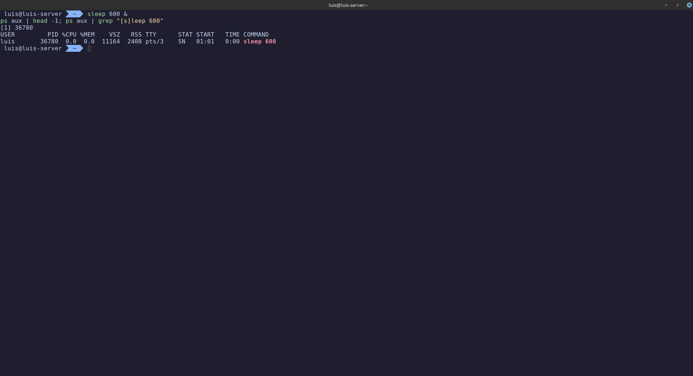
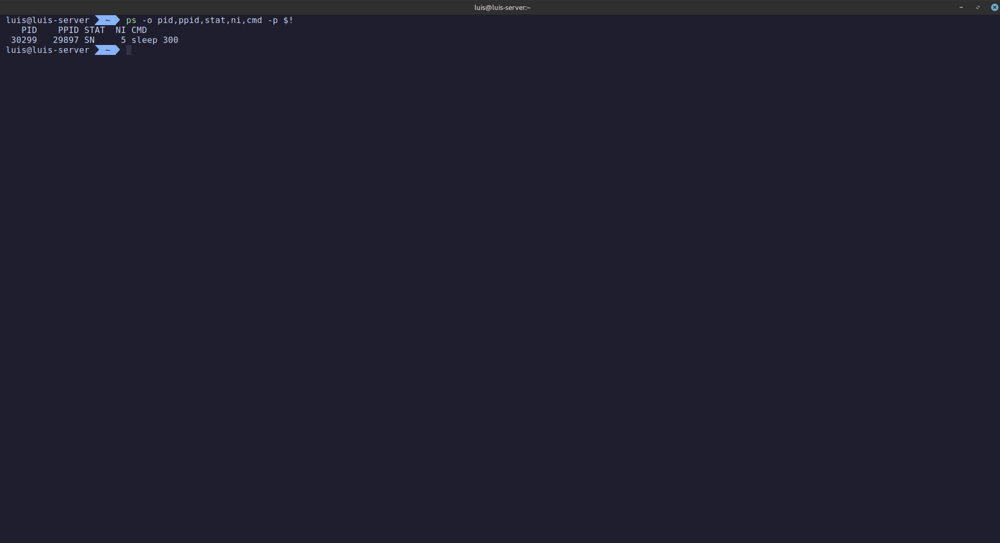
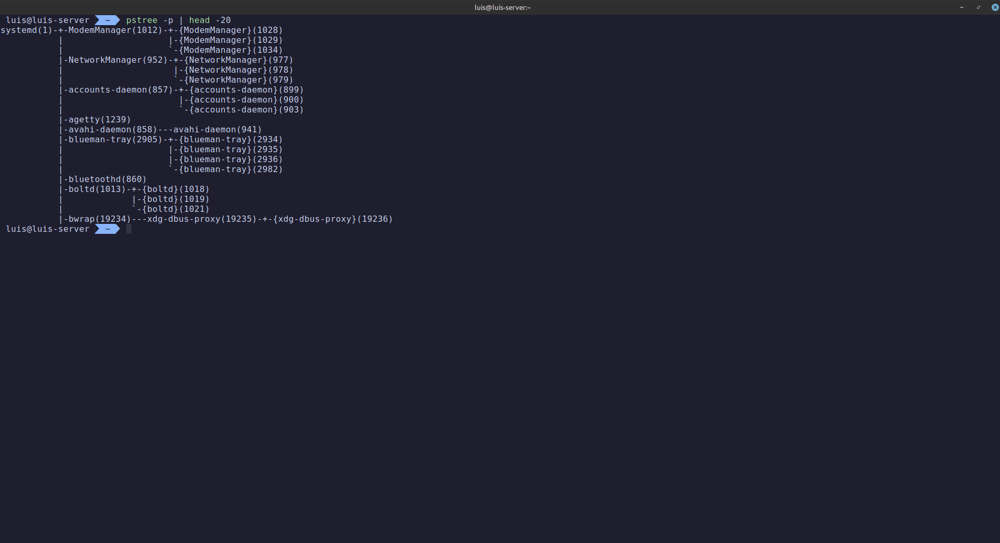
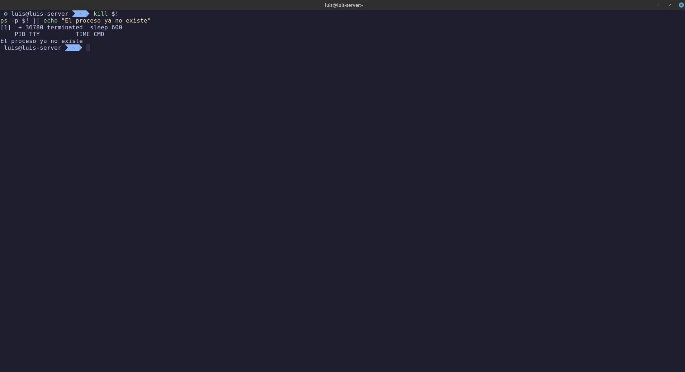

**Explicación:** Lancé un proceso de prueba (`sleep`) en segundo plano y lo localicé con
`ps`. Cada proceso tiene un **PID** único y un **PPID**, que es el PID del proceso que lo
creó: aquí, la terminal desde donde lo lancé. El campo `STAT` indica su estado; `S` es
"dormido, esperando" y la `N` indica que corre con prioridad reducida. `pstree` muestra que
todos los procesos forman un árbol cuya raíz es `systemd` (PID 1). Con `kill` terminé el
proceso y `ps` confirmó que ya no existe.

**Comparación con el simulador:** el comando `crear proceso` registra un pid, un nombre y un
estado, igual que `ps` muestra PID, comando y estado. `finalizar proceso` equivale a `kill`.
Linux guarda además el proceso padre y mucha más información.

---

## Práctica 2. Prioridades

Capturas: `05_nice.png`, `06_renice.png`, `08_renice_denegado.png`

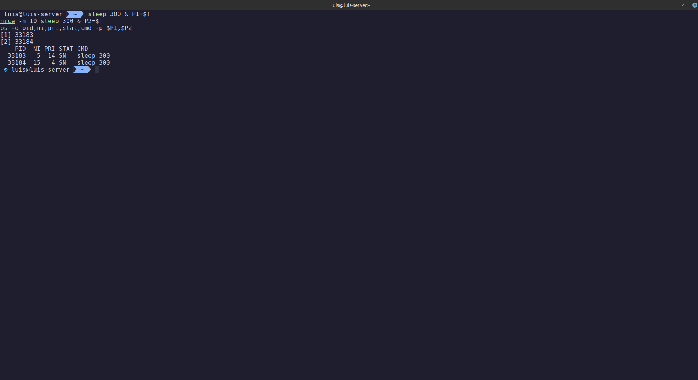
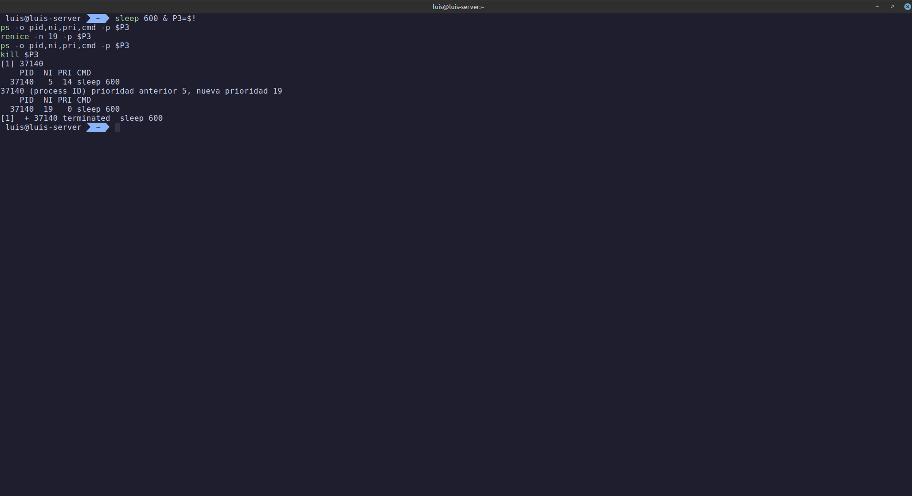
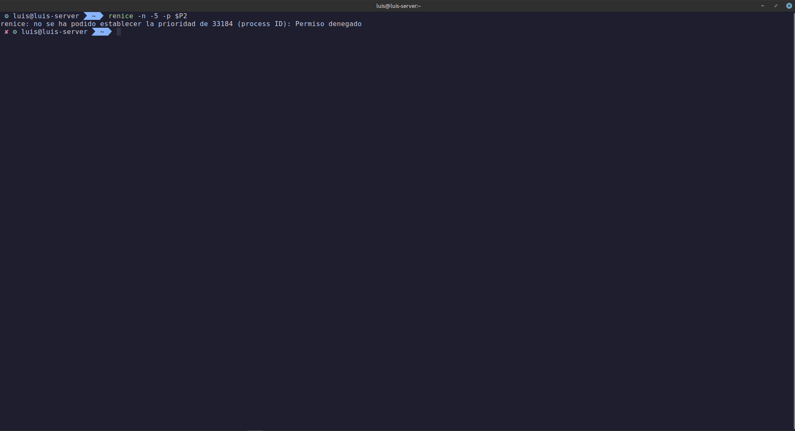

**Explicación:** Lancé dos procesos iguales, uno de ellos con `nice -n 10`. En `ps` el valor
`NI` del segundo es 10 unidades mayor y su `PRI` es menor, es decir, tiene menos prioridad
para recibir CPU. Con `renice -n 19` cambié el valor nice de un proceso que ya estaba
corriendo, de 5 a 19: su `PRI` bajó de 14 a 0, la prioridad mínima. Al intentar lo contrario (`renice -n -5`, dar más prioridad) el sistema respondió
"Permiso denegado": un usuario normal solo puede bajar la prioridad de sus procesos; subirla
requiere privilegios de administrador (`sudo`).

**Comparación con el simulador:** el simulador guarda `prioridad` como dato del proceso, pero
FCFS, SJF y Round Robin no la usan para decidir; Linux sí la usa para repartir la CPU.

---

## Práctica 3. Hilos

Capturas: `09_nlwp.png`, `10_hilos_proceso.png`, `11_top_hilos.png`,
`12_python_hilos.png`, `13_simulador_hilos.png`

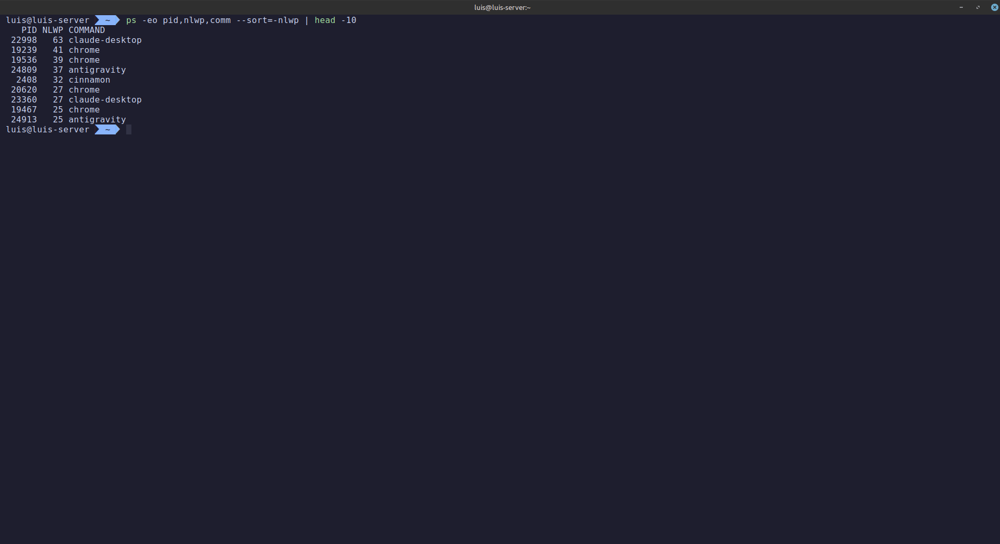
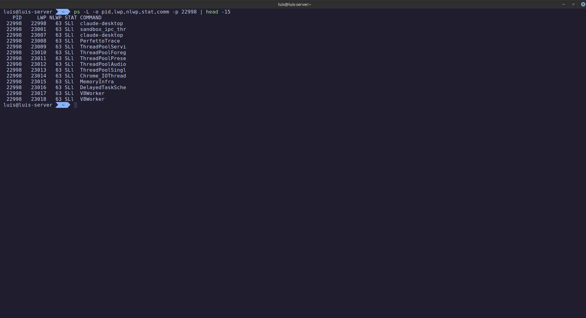
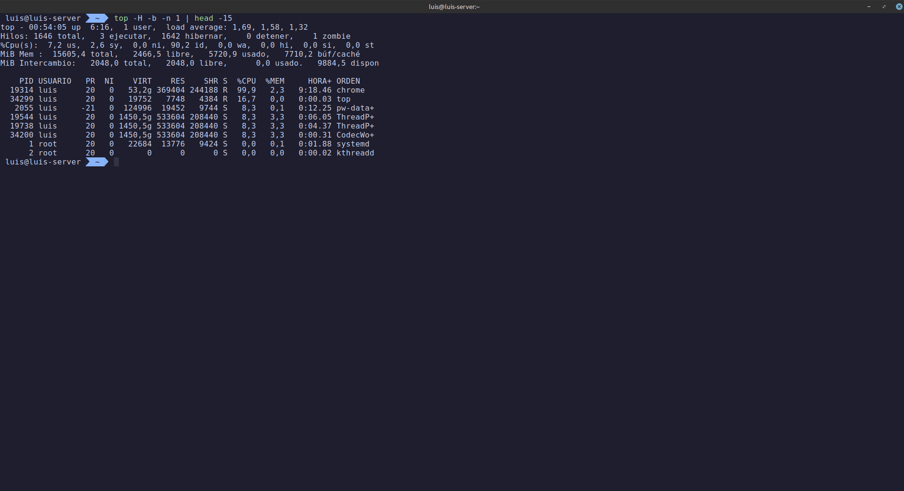
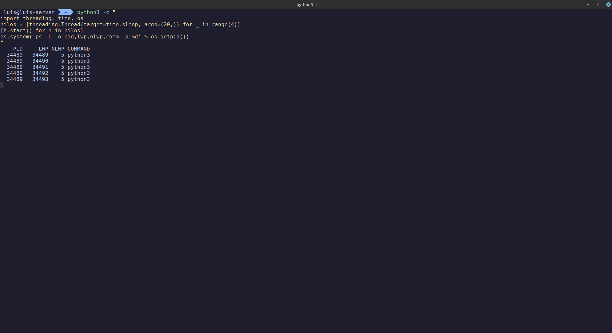
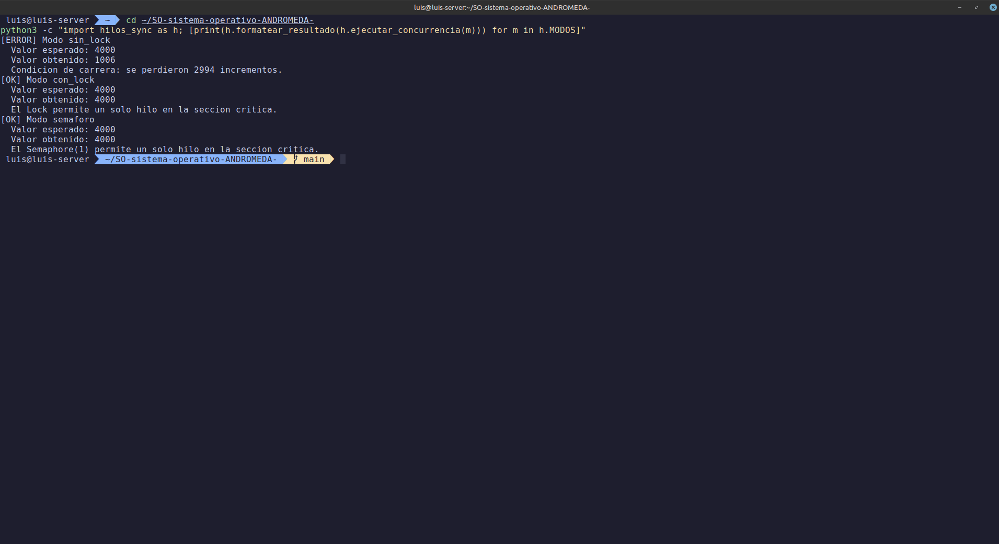

**Explicación:** La columna `NLWP` de `ps` muestra cuántos hilos tiene cada proceso; los
programas reales (navegador, editor, escritorio) tienen decenas. Todos los hilos de un
proceso comparten el mismo **PID** y se distinguen por su `LWP`. En `top -H` cada hilo
aparece como una fila y los hilos del mismo proceso muestran la misma memoria (`VIRT`,
`RES`), porque la comparten. Un programa propio en Python con 4 hilos aparece con 5 en
`NLWP`: los 4 más el hilo principal.

**Comparación con el simulador:** `hilos_sync.py` hace lo mismo a pequeña escala. Con
`sin_lock` los hilos comparten un contador sin protección y se pierden incrementos (se
obtuvo 1006 de 4000: condición de carrera). Con `con_lock` y `semaforo` solo un hilo a la vez
entra a la sección crítica y el resultado es exacto: 4000 de 4000.

---

## Práctica 4. Permisos

Capturas: `14_ls_l.png`, `15_sin_lectura.png`, `16_chmod_ejecucion.png`,
`17_chmod_simbolico.png`

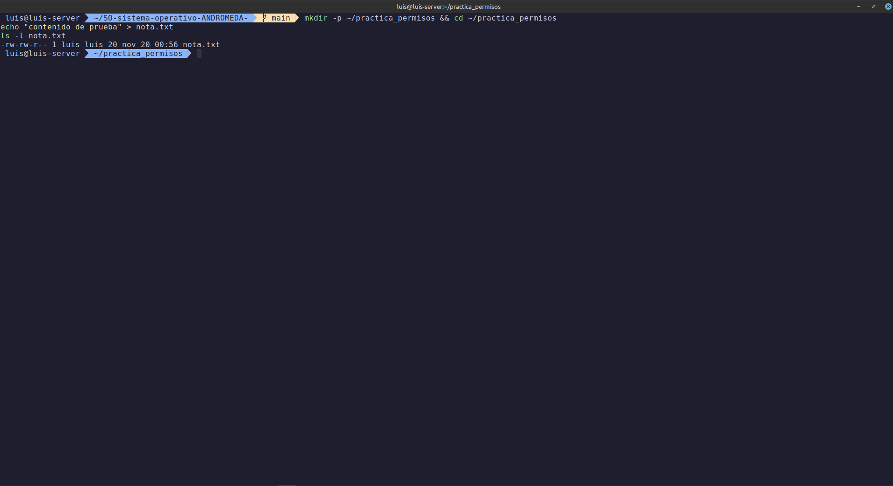
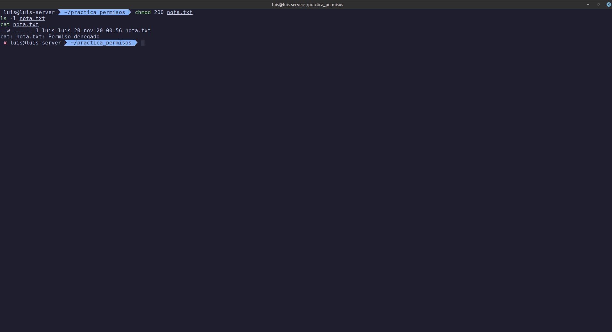
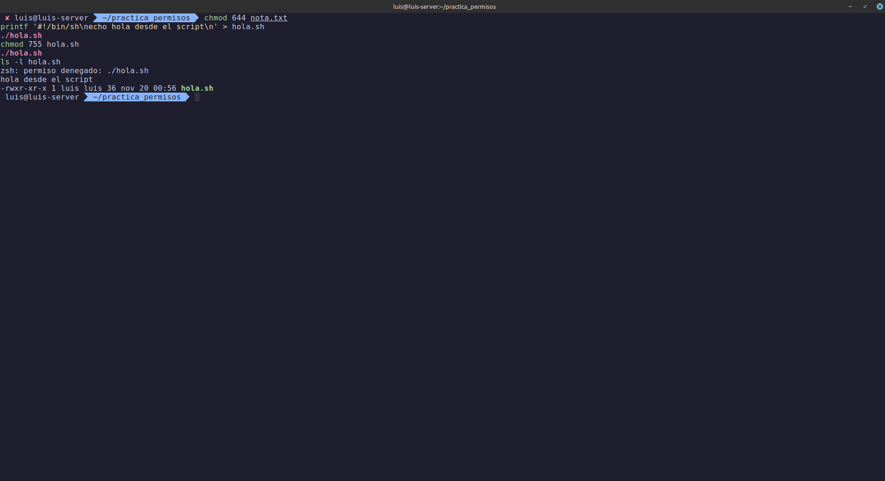

**Explicación:** `ls -l` muestra los permisos en tres bloques (dueño, grupo y otros), cada
uno con lectura `r`, escritura `w` y ejecución `x`. Con `chmod 200` dejé el archivo solo con
escritura y `cat` falló con "Permiso denegado", incluso siendo yo el dueño. Un script recién
creado no se ejecuta porque no tiene el permiso `x`; tras `chmod 755` sí corre. Con la forma
simbólica (`u+x,g-w,o-r`) modifiqué permisos concretos y quedó `rwxr-----`. `id` muestra
mi usuario y los grupos a los que pertenezco, que es lo que Linux usa para decidir el acceso.

**Comparación con el simulador:** el simulador no tiene usuarios ni permisos. Su protección
consiste en que `archivos.py` solo trabaja dentro de `carpeta_pruebas/` y rechaza rutas con
`..`.
