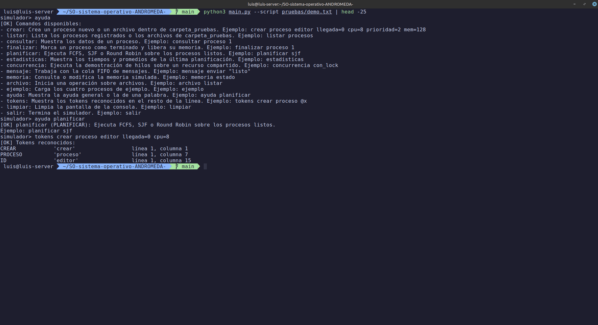
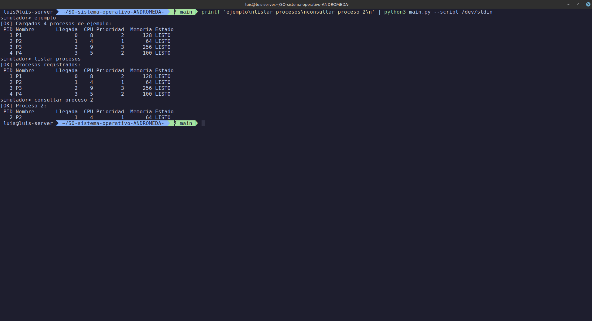
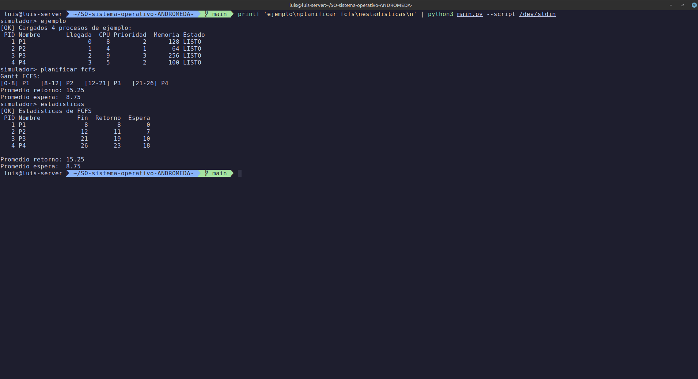
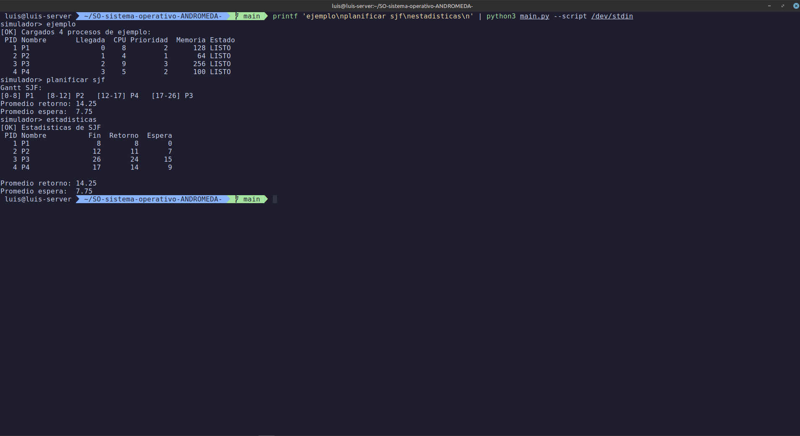
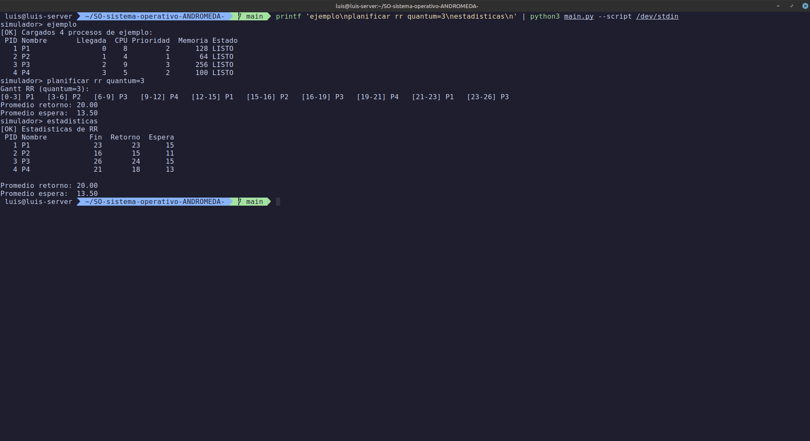
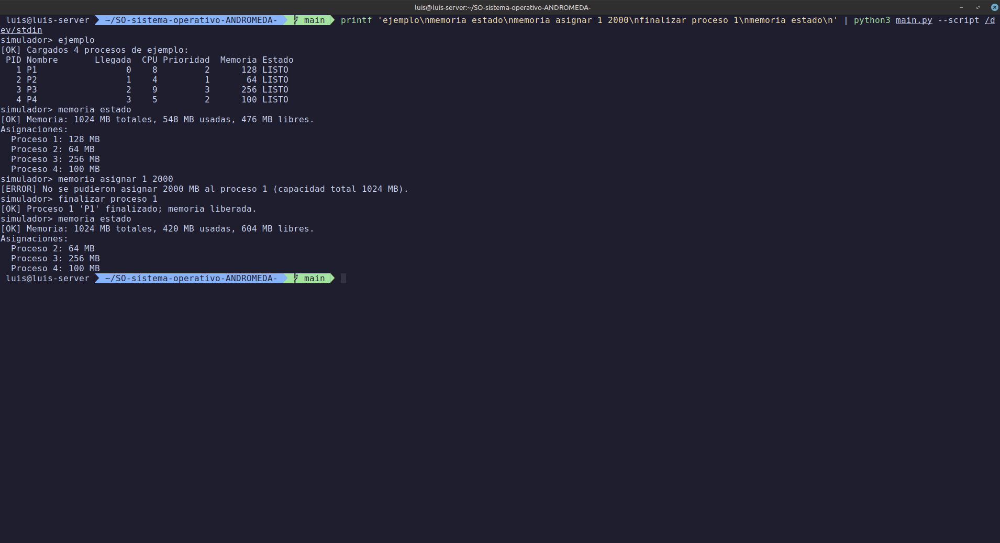
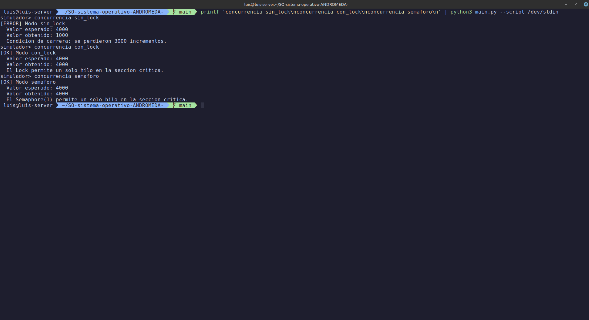
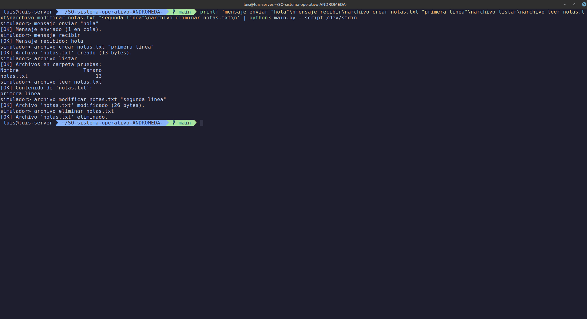
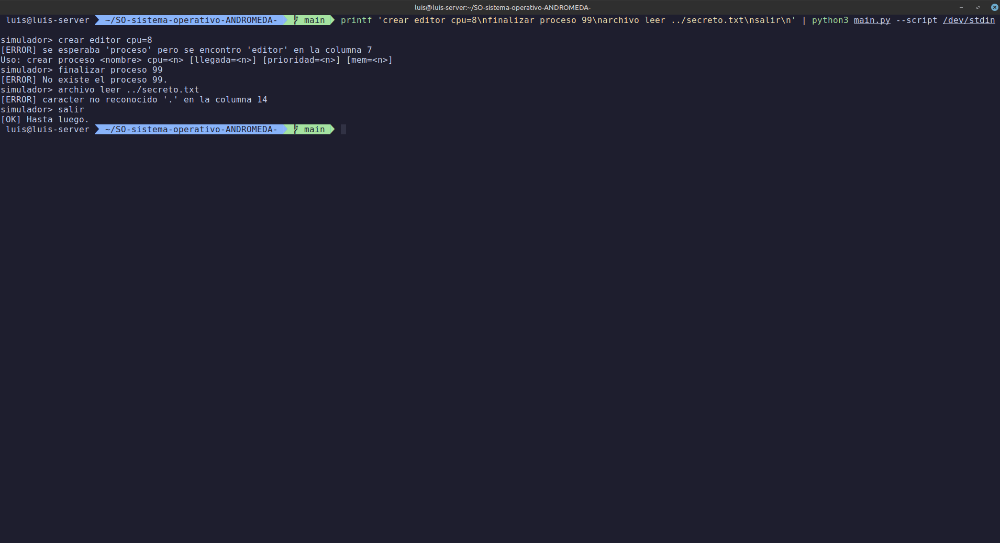
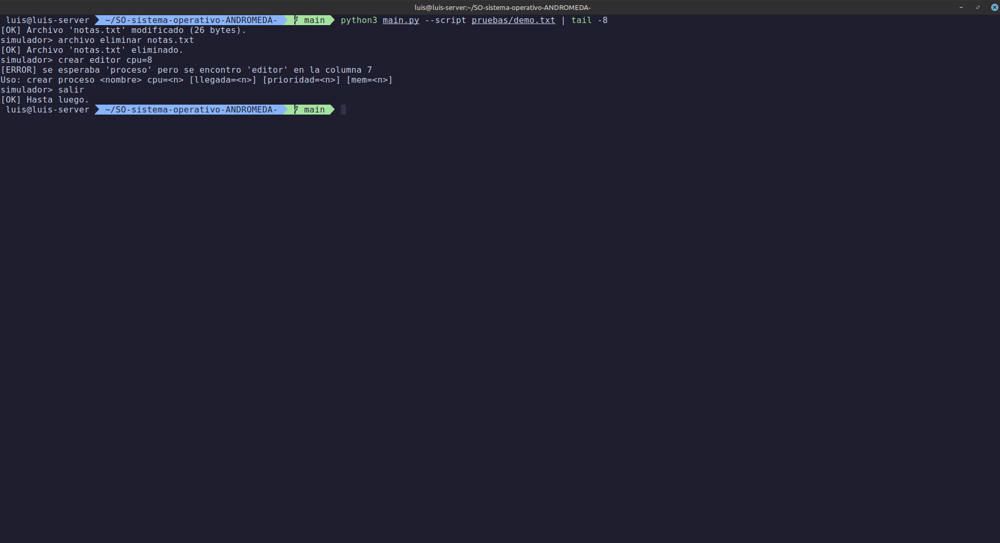

# Evidencias de pruebas de extremo a extremo (T5.4)

Se ejecutó la sesión de ejemplo del simulador con
`python3 main.py --script pruebas/demo.txt`, dividida en bloques para que cada captura
sea legible. Todos los comandos pasan por el mismo flujo: lexer, parser, despachador y módulo.

Datos de ejemplo (`ejemplo`):

| PID | Nombre | Llegada | CPU | Prioridad | Memoria (MB) |
|---|---|---|---|---|---|
| 1 | P1 | 0 | 8 | 2 | 128 |
| 2 | P2 | 1 | 4 | 1 | 64 |
| 3 | P3 | 2 | 9 | 3 | 256 |
| 4 | P4 | 3 | 5 | 2 | 100 |

---

## 1. Ayuda y tokens

Captura: `01_demo_inicio.png`

**Explicación:** La sesión arranca con `ayuda`, que lista los 15 comandos con su definición
y un ejemplo, y con `ayuda planificar`, que detalla un comando. `tokens` muestra cómo el
lexer divide una línea en componentes (`CREAR`, `PROCESO`, `ID`...) con su línea y columna.
Todos los mensajes de éxito empiezan con `[OK]`.

## 2. Procesos

Captura: `02_procesos.png`

**Explicación:** `ejemplo` carga los cuatro procesos de prueba en estado `LISTO`, `listar
procesos` los muestra en una tabla y `consultar proceso 2` muestra solo el P2. Cada proceso
tiene pid, nombre, llegada, CPU, prioridad, memoria y estado, como pide el enunciado.

## 3. Planificación FCFS

Captura: `03_fcfs.png`

**Explicación:** FCFS atiende los procesos en orden de llegada: P1, P2, P3 y P4. El
diagrama de Gantt es `[0-8] P1 [8-12] P2 [12-21] P3 [21-26] P4`. Los promedios son
**retorno 15,25** y **espera 8,75**. P4 espera 18 unidades porque llegó último y tuvo que
esperar a que terminaran los tres anteriores.

## 4. Planificación SJF no expulsivo

Captura: `04_sjf.png`

**Explicación:** SJF elige, entre los procesos que ya llegaron, el de menor CPU. Tras P1 y
P2 pasa P4 (5 unidades) antes que P3 (9). Promedios: **retorno 14,25** y **espera 7,75**,
mejores que FCFS. Es el costo de adelantar a los procesos cortos: P3 espera 15 unidades.

## 5. Planificación Round Robin

Captura: `05_round_robin.png`

**Explicación:** Round Robin con quantum 3 reparte la CPU en turnos de hasta 3 unidades y
devuelve el proceso al final de la cola si no ha terminado. Por eso los procesos se
intercalan (P1, P2, P3, P4, P1...). Promedios: **retorno 20,00** y **espera 13,50**, los
peores de los tres, pero ningún proceso espera mucho para recibir CPU por primera vez.

**Comparación de los tres algoritmos**

| Algoritmo | Promedio retorno | Promedio espera |
|---|---|---|
| FCFS | 15,25 | 8,75 |
| SJF | 14,25 | 7,75 |
| RR (quantum 3) | 20,00 | 13,50 |

## 6. Memoria

Captura: `06_memoria.png`

**Explicación:** La memoria simulada tiene 1024 MB. Con los cuatro procesos cargados hay
548 MB usados y 476 libres. Al intentar asignar 2000 MB al proceso 1, el simulador responde
`[ERROR]` porque supera la capacidad. Al finalizar el proceso 1 se libera su memoria y
quedan 420 MB usados y 604 libres.

## 7. Concurrencia y sincronización

Captura: `07_concurrencia.png`

**Explicación:** Cuatro hilos incrementan 1000 veces un contador compartido, por lo que el
valor esperado es 4000. Sin protección (`sin_lock`) se obtuvo 1000 y se perdieron 3000
incrementos: es una condición de carrera, porque varios hilos leen el mismo valor y se
sobrescriben. Con `Lock` (`con_lock`) y con `Semaphore(1)` (`semaforo`) solo un hilo a la
vez entra a la sección crítica y el resultado es exacto: 4000.

## 8. Mensajes y archivos

Captura: `08_mensajes_archivos.png`

**Explicación:** La cola de mensajes funciona como FIFO: `mensaje enviar "hola"` lo agrega
y `mensaje recibir` entrega el más antiguo. Para archivos se probó el ciclo completo en
`carpeta_pruebas`: crear, listar, leer, modificar (agrega texto al final, de 13 a 26 bytes)
y eliminar.

## 9. Errores controlados

Captura: `09_errores.png`

**Explicación:** Se probaron tres entradas inválidas. `crear editor cpu=8` (falta la palabra
`proceso`) devuelve `[ERROR]` con la columna y el uso correcto. `finalizar proceso 99`
informa que el proceso no existe. `archivo leer ../secreto.txt` es rechazado por el lexer, que
no reconoce el carácter `.` en esa posición, por lo que no se llega a leer fuera de
`carpeta_pruebas`. En ningún caso aparece un error técnico (traceback) y el programa sigue
funcionando hasta `salir`.

## 10. Fin de la sesión

Captura: `10_demo_final.png`

**Explicación:** La demo termina con el error de sintaxis intencional y el comando `salir`,
que muestra `[OK] Hasta luego.`. Esto confirma que la sesión completa se ejecuta de principio
a fin sin caerse.
