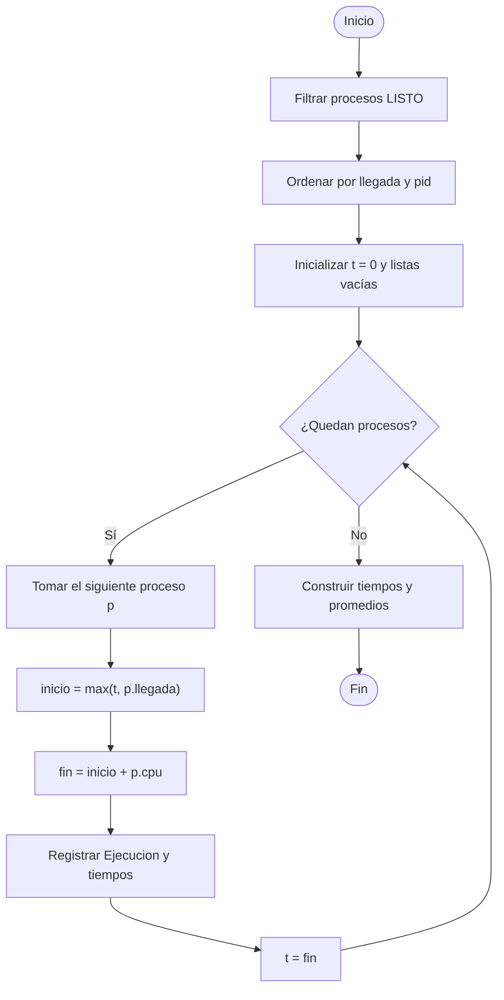
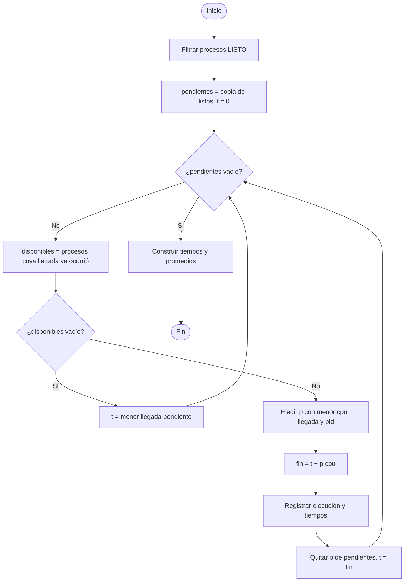
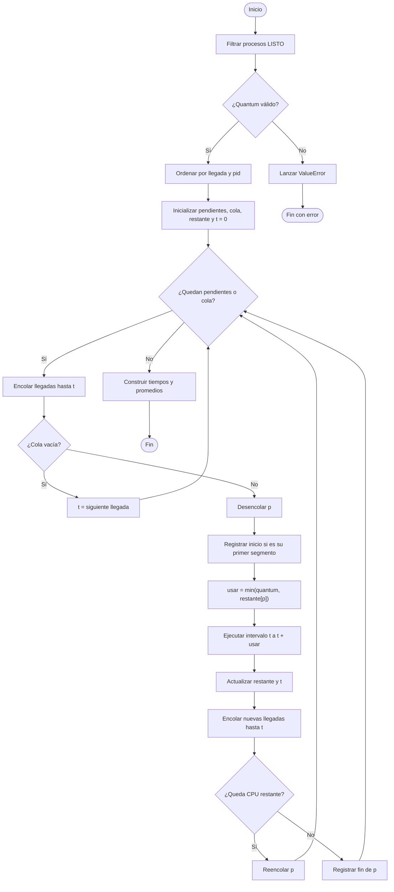

# Pseudocódigo y Diagramas de Flujo de los Planificadores

- **Tarea:** T1.5
- **Fase:** 1. Diseño
- **Responsable:** A
- **Depende de:** T1.2
- **Estado:** v1
- **Requisitos:** Python 3.10 o superior, solo biblioteca estándar.

Este documento define el pseudocódigo y el diagrama de flujo de FCFS, SJF no
expulsivo y Round Robin. Las reglas y estructuras de retorno respetan el
[contrato de proceso y planificadores](./contrato_proceso.md).

Los diagramas están escritos en Mermaid y GitHub los renderiza directamente. Debajo
de cada diagrama se incluye un flujo numerado equivalente para que el documento
pueda leerse en cualquier editor de texto.

## 1. Datos de prueba

Se utilizan los cuatro procesos verificados del contrato T1.2:

| Proceso | Llegada | CPU | Prioridad | Memoria (MB) |
|---|---:|---:|---:|---:|
| P1 | 0 | 8 | 2 | 128 |
| P2 | 1 | 4 | 1 | 64 |
| P3 | 2 | 9 | 3 | 256 |
| P4 | 3 | 5 | 2 | 100 |

La prioridad y la memoria no influyen en FCFS, SJF ni Round Robin. Los cuatro
procesos se consideran en estado `LISTO`.

## 2. Convenciones del pseudocódigo

- `listos`: procesos con estado `LISTO`.
- `pendientes`: procesos que todavía no han sido ejecutados o que aún no han
  llegado, según el algoritmo.
- `cola`: cola FIFO de procesos.
- `restante[pid]`: tiempo de CPU que le falta a un proceso en Round Robin.
- `t`: tiempo actual de la simulación.
- `ejecuciones`: lista de segmentos `(pid, nombre, inicio, fin)` para el Gantt.
- `inicio_por_pid`: primer instante en que cada proceso recibe CPU.
- `fin_por_pid`: instante en que cada proceso termina.
- `tiempos`: lista de registros `TiempoProceso`.
- Los empates se resuelven por `pid` ascendente.
- Las llegadas simultáneas se atienden en orden de `pid`.
- Un hueco sin procesos listos no genera una `Ejecucion`; el Gantt lo muestra
  como `(libre)`.
- Los planificadores no modifican los objetos `Proceso`.

### 2.1 Funciones auxiliares

```text
FUNCION construir_tiempos(procesos, inicio_por_pid, fin_por_pid):
    tiempos <- []
    para cada p en procesos ordenados por pid:
        si p.pid existe en fin_por_pid:
            inicio <- inicio_por_pid[p.pid]
            fin <- fin_por_pid[p.pid]
            retorno <- fin - p.llegada
            espera <- retorno - p.cpu
            agregar TiempoProceso(
                p.pid, p.nombre, p.llegada, p.cpu,
                inicio, fin, retorno, espera
            ) a tiempos
    retornar tiempos


FUNCION promedios(tiempos):
    si tiempos está vacío:
        retornar (0.0, 0.0)
    n <- cantidad de elementos de tiempos
    suma_retorno <- suma(t.retorno para t en tiempos)
    suma_espera <- suma(t.espera para t en tiempos)
    retornar (suma_retorno / n, suma_espera / n)


FUNCION construir_resultado(algoritmo, quantum, ejecuciones, tiempos):
    (promedio_retorno, promedio_espera) <- promedios(tiempos)
    retornar ResultadoPlanificacion(
        algoritmo, quantum, ejecuciones, tiempos,
        promedio_retorno, promedio_espera
    )
```

## 3. FCFS

### 3.1 Pseudocódigo

```text
ALGORITMO fcfs(procesos):
    listos <- filtrar procesos con estado LISTO
    ordenar listos por (llegada, pid)

    t <- 0
    ejecuciones <- []
    inicio_por_pid <- {}
    fin_por_pid <- {}

    para cada p en listos:
        inicio <- max(t, p.llegada)
        fin <- inicio + p.cpu
        agregar Ejecucion(p.pid, p.nombre, inicio, fin) a ejecuciones
        inicio_por_pid[p.pid] <- inicio
        fin_por_pid[p.pid] <- fin
        t <- fin

    tiempos <- construir_tiempos(listos, inicio_por_pid, fin_por_pid)
    retornar construir_resultado("FCFS", None, ejecuciones, tiempos)
```

### 3.2 Diagrama de flujo



### 3.3 Flujo numerado

1. Filtrar los procesos en estado `LISTO`.
2. Ordenarlos por `(llegada, pid)`.
3. Inicializar `t = 0` y las listas de ejecuciones y tiempos.
4. Para cada proceso:
   - Calcular `inicio = max(t, llegada)`.
   - Calcular `fin = inicio + cpu`.
   - Registrar la ejecución y el tiempo del proceso.
   - Actualizar `t = fin`.
5. Construir los tiempos y promedios.
6. Retornar `ResultadoPlanificacion` con algoritmo `"FCFS"` y `quantum = None`.

### 3.4 Prueba manual con P1–P4

Los procesos ya están ordenados por llegada: P1, P2, P3, P4.

| Paso | `t` antes | Proceso elegido | Intervalo | `t` después |
|---|---:|---|---|---:|
| 1 | 0 | P1 | 0–8 | 8 |
| 2 | 8 | P2 | 8–12 | 12 |
| 3 | 12 | P3 | 12–21 | 21 |
| 4 | 21 | P4 | 21–26 | 26 |

Gantt:

```text
P1 0-8, P2 8-12, P3 12-21, P4 21-26
```

| Proceso | Inicio | Fin | Retorno | Espera |
|---|---:|---:|---:|---:|
| P1 | 0 | 8 | 8 | 0 |
| P2 | 8 | 12 | 11 | 7 |
| P3 | 12 | 21 | 19 | 10 |
| P4 | 21 | 26 | 23 | 18 |

Verificación:

```text
Retorno promedio = (8 + 11 + 19 + 23) / 4 = 61 / 4 = 15.25
Espera promedio  = (0 + 7 + 10 + 18) / 4 = 35 / 4 = 8.75
```

## 4. SJF no expulsivo

### 4.1 Pseudocódigo

```text
ALGORITMO sjf(procesos):
    listos <- filtrar procesos con estado LISTO
    pendientes <- copia de listos

    t <- 0
    ejecuciones <- []
    inicio_por_pid <- {}
    fin_por_pid <- {}

    mientras pendientes no esté vacío:
        disponibles <- [p en pendientes | p.llegada <= t]

        si disponibles está vacío:
            t <- min(p.llegada para p en pendientes)
            continuar

        p <- min(disponibles, clave=(p.cpu, p.llegada, p.pid))
        inicio <- t
        fin <- t + p.cpu

        agregar Ejecucion(p.pid, p.nombre, inicio, fin) a ejecuciones
        inicio_por_pid[p.pid] <- inicio
        fin_por_pid[p.pid] <- fin

        quitar p de pendientes
        t <- fin

    tiempos <- construir_tiempos(listos, inicio_por_pid, fin_por_pid)
    retornar construir_resultado("SJF", None, ejecuciones, tiempos)
```

### 4.2 Diagrama de flujo



### 4.3 Flujo numerado

1. Filtrar los procesos en estado `LISTO`.
2. Copiarlos en `pendientes` e inicializar `t = 0`.
3. Mientras queden pendientes:
   - Obtener los que ya llegaron (`llegada <= t`).
   - Si no hay disponibles, avanzar `t` hasta la menor llegada pendiente.
   - Elegir el de menor `(cpu, llegada, pid)`.
   - Ejecutarlo completo, desde `t` hasta `t + cpu`.
   - Registrarlo, quitarlo de pendientes y actualizar `t`.
4. Construir tiempos y promedios.
5. Retornar `ResultadoPlanificacion` con algoritmo `"SJF"` y `quantum = None`.

### 4.4 Prueba manual con P1–P4

| Paso | `t` antes | Disponibles | Elegido | Intervalo | `t` después |
|---|---:|---|---|---|---:|
| 1 | 0 | P1 | P1 (cpu 8) | 0–8 | 8 |
| 2 | 8 | P2 (4), P3 (9), P4 (5) | P2 | 8–12 | 12 |
| 3 | 12 | P3 (9), P4 (5) | P4 | 12–17 | 17 |
| 4 | 17 | P3 (9) | P3 | 17–26 | 26 |

Gantt:

```text
P1 0-8, P2 8-12, P4 12-17, P3 17-26
```

| Proceso | Inicio | Fin | Retorno | Espera |
|---|---:|---:|---:|---:|
| P1 | 0 | 8 | 8 | 0 |
| P2 | 8 | 12 | 11 | 7 |
| P3 | 17 | 26 | 24 | 15 |
| P4 | 12 | 17 | 14 | 9 |

Verificación:

```text
Retorno promedio = (8 + 11 + 24 + 14) / 4 = 57 / 4 = 14.25
Espera promedio  = (0 + 7 + 15 + 9) / 4 = 31 / 4 = 7.75
```

## 5. Round Robin con quantum 3

### 5.1 Pseudocódigo

```text
ALGORITMO rr(procesos, quantum=3):
    si quantum < 1:
        lanzar ValueError("El quantum debe ser mayor o igual que 1")

    listos <- filtrar procesos con estado LISTO
    ordenar listos por (llegada, pid)

    pendientes <- deque(listos)
    restante <- {p.pid: p.cpu para p en listos}
    cola <- deque()

    t <- 0
    ejecuciones <- []
    inicio_por_pid <- {}
    fin_por_pid <- {}

    mientras pendientes no esté vacío o cola no esté vacía:
        mientras pendientes no esté vacío y pendientes[0].llegada <= t:
            cola.append(pendientes.popleft())

        si cola está vacía:
            t <- pendientes[0].llegada
            continuar

        p <- cola.popleft()
        usar <- min(quantum, restante[p.pid])
        inicio <- t
        fin <- t + usar

        agregar Ejecucion(p.pid, p.nombre, inicio, fin) a ejecuciones
        si p.pid no está en inicio_por_pid:
            inicio_por_pid[p.pid] <- inicio

        restante[p.pid] <- restante[p.pid] - usar
        t <- fin

        mientras pendientes no esté vacío y pendientes[0].llegada <= t:
            cola.append(pendientes.popleft())

        si restante[p.pid] > 0:
            cola.append(p)
        si no:
            fin_por_pid[p.pid] <- fin

    tiempos <- construir_tiempos(listos, inicio_por_pid, fin_por_pid)
    retornar construir_resultado("RR", quantum, ejecuciones, tiempos)
```

### 5.2 Diagrama de flujo



### 5.3 Flujo numerado

1. Validar que `quantum >= 1`; si no, lanzar `ValueError`.
2. Filtrar los procesos en estado `LISTO` y ordenarlos por `(llegada, pid)`.
3. Crear la cola, la cola de pendientes y el mapa de tiempo restante.
4. Mientras haya pendientes o procesos en la cola:
   - Encolar todos los procesos cuya llegada sea `<= t`.
   - Si la cola está vacía, avanzar `t` hasta la siguiente llegada.
   - Desencolar el primer proceso.
   - Ejecutarlo como máximo `quantum` unidades o hasta terminar.
   - Registrar la ejecución y, si es su primer segmento, su inicio.
   - Actualizar el tiempo restante y `t`.
   - Encolar las llegadas de ese instante.
   - Si aún le queda CPU, reencolarlo; si terminó, registrar su fin.
5. Construir tiempos y promedios.
6. Retornar `ResultadoPlanificacion` con algoritmo `"RR"` y el quantum usado.

### 5.4 Prueba manual con P1–P4 y quantum 3

Al iniciar, solo P1 está disponible. Las llegadas de P2, P3 y P4 ocurren durante
el primer quantum. En el instante `t = 3` primero se encolan las llegadas y
después se reencola P1.

| Paso | `t` inicial | Cola al iniciar | Elegido | Usar | Intervalo | Restante | Cola al final |
|---|---:|---|---|---:|---|---:|---|
| 1 | 0 | P1 | P1 | 3 | 0–3 | P1 = 5 | P2, P3, P4, P1 |
| 2 | 3 | P2, P3, P4, P1 | P2 | 3 | 3–6 | P2 = 1 | P3, P4, P1, P2 |
| 3 | 6 | P3, P4, P1, P2 | P3 | 3 | 6–9 | P3 = 6 | P4, P1, P2, P3 |
| 4 | 9 | P4, P1, P2, P3 | P4 | 3 | 9–12 | P4 = 2 | P1, P2, P3, P4 |
| 5 | 12 | P1, P2, P3, P4 | P1 | 3 | 12–15 | P1 = 2 | P2, P3, P4, P1 |
| 6 | 15 | P2, P3, P4, P1 | P2 | 1 | 15–16 | P2 = 0 | P3, P4, P1 |
| 7 | 16 | P3, P4, P1 | P3 | 3 | 16–19 | P3 = 3 | P4, P1, P3 |
| 8 | 19 | P4, P1, P3 | P4 | 2 | 19–21 | P4 = 0 | P1, P3 |
| 9 | 21 | P1, P3 | P1 | 2 | 21–23 | P1 = 0 | P3 |
| 10 | 23 | P3 | P3 | 3 | 23–26 | P3 = 0 | vacía |

Gantt:

```text
P1 0-3, P2 3-6, P3 6-9, P4 9-12, P1 12-15, P2 15-16,
P3 16-19, P4 19-21, P1 21-23, P3 23-26
```

| Proceso | Inicio | Fin | Retorno | Espera |
|---|---:|---:|---:|---:|
| P1 | 0 | 23 | 23 | 15 |
| P2 | 3 | 16 | 15 | 11 |
| P3 | 6 | 26 | 24 | 15 |
| P4 | 9 | 21 | 18 | 13 |

Verificación:

```text
Retorno promedio = (23 + 15 + 24 + 18) / 4 = 80 / 4 = 20.00
Espera promedio  = (15 + 11 + 15 + 13) / 4 = 54 / 4 = 13.50
```

## 6. Resumen de la prueba manual

| Algoritmo | Gantt | Finalización (P1, P2, P3, P4) | Retorno promedio | Espera promedio |
|---|---|---|---:|---:|
| FCFS | P1, P2, P3, P4 | 8, 12, 21, 26 | 15.25 | 8.75 |
| SJF | P1, P2, P4, P3 | 8, 12, 26, 17 | 14.25 | 7.75 |
| RR q=3 | P1, P2, P3, P4, P1, P2, P3, P4, P1, P3 | 23, 16, 26, 21 | 20.00 | 13.50 |

Los valores coinciden con los ejemplos verificados de `docs/contrato_proceso.md`.

## 7. Casos límite

| Caso | Comportamiento esperado |
|---|---|
| No hay procesos `LISTO` | Resultado vacío y promedios `0.0`. |
| La CPU queda libre antes de la primera llegada | `t` avanza hasta la llegada; no se crea una ejecución ficticia. |
| Dos procesos llegan al mismo tiempo | Se atienden por `pid` ascendente. |
| SJF empata en CPU y llegada | Se elige el `pid` menor. |
| Round Robin recibe `quantum <= 0` | Se lanza `ValueError`. |
| Un proceso termina exactamente al final del quantum | No se reencola; se registra su fin. |
| Un proceso llega justo al terminar un quantum | Entra a la cola antes que el proceso interrumpido. |
| Hay procesos `RECHAZADO` o `TERMINADO` | Se ignoran; solo se planifican los `LISTO`. |
| Se planifica dos veces con los mismos procesos | El resultado es idéntico porque no se mutan los procesos. |

## 8. Criterios de aceptación de T1.5

- [x] Pseudocódigo de FCFS.
- [x] Diagrama de flujo de FCFS.
- [x] Pseudocódigo de SJF no expulsivo.
- [x] Diagrama de flujo de SJF no expulsivo.
- [x] Pseudocódigo de Round Robin.
- [x] Diagrama de flujo de Round Robin.
- [x] Traza manual de los tres algoritmos con P1–P4.
- [x] Promedios de retorno y espera verificados a mano.
- [x] Casos límite documentados.
- [x] Contrato T1.2 respetado.
